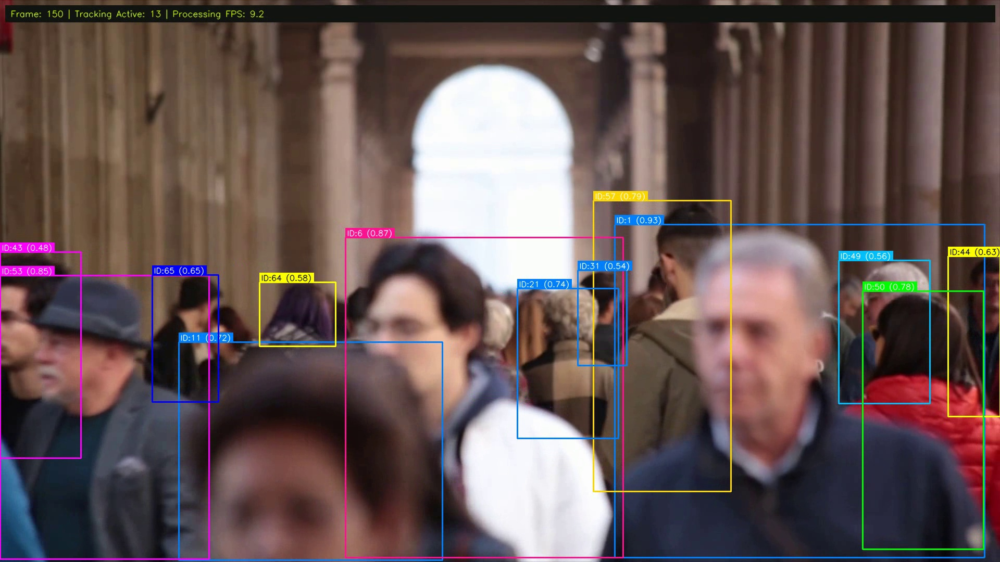
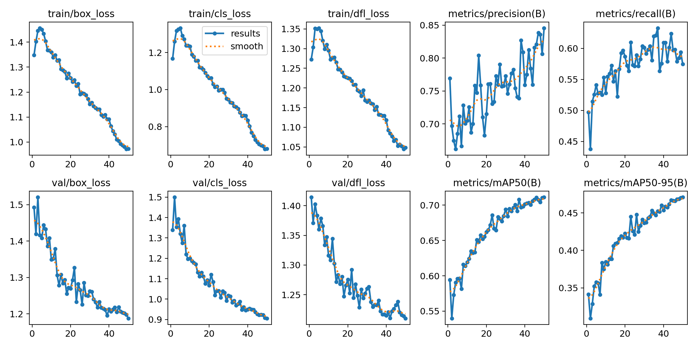
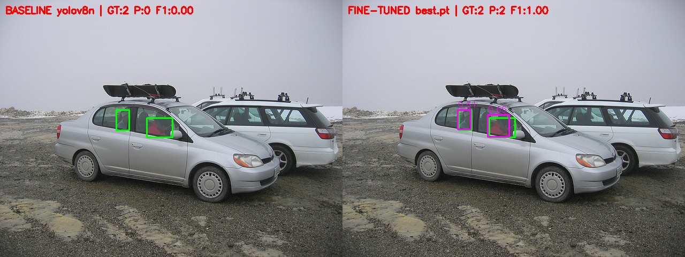
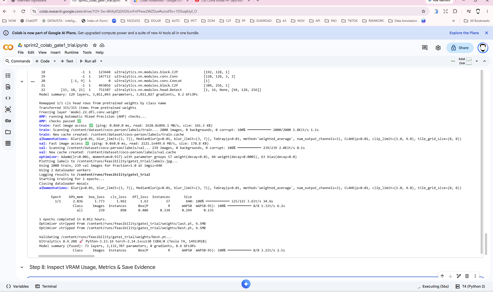
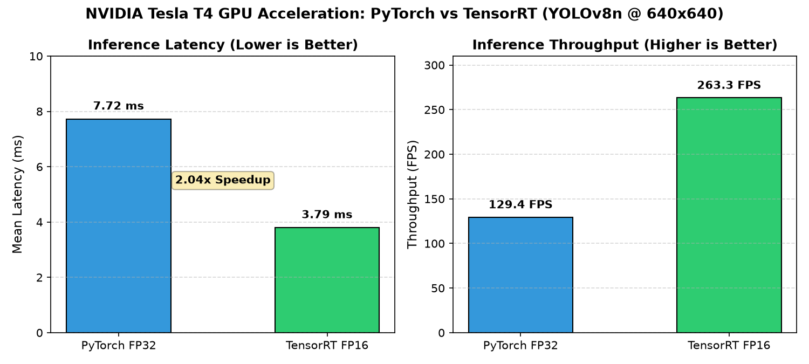
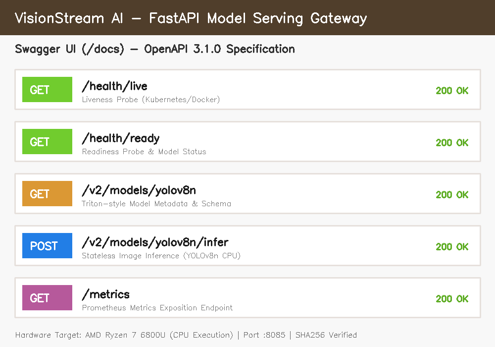
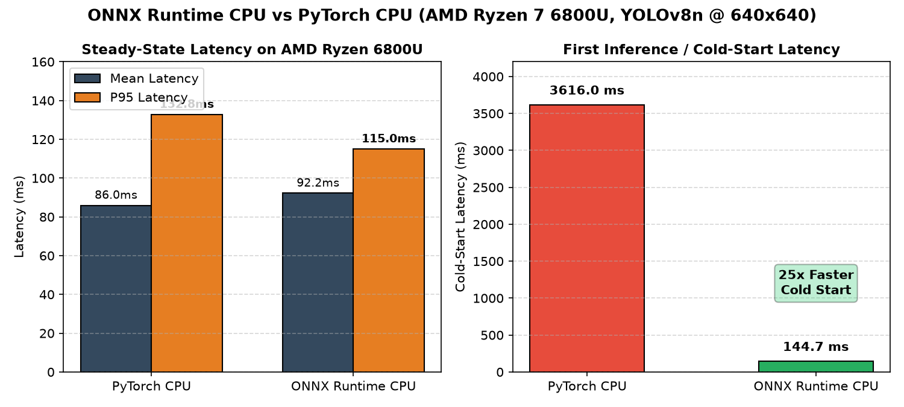
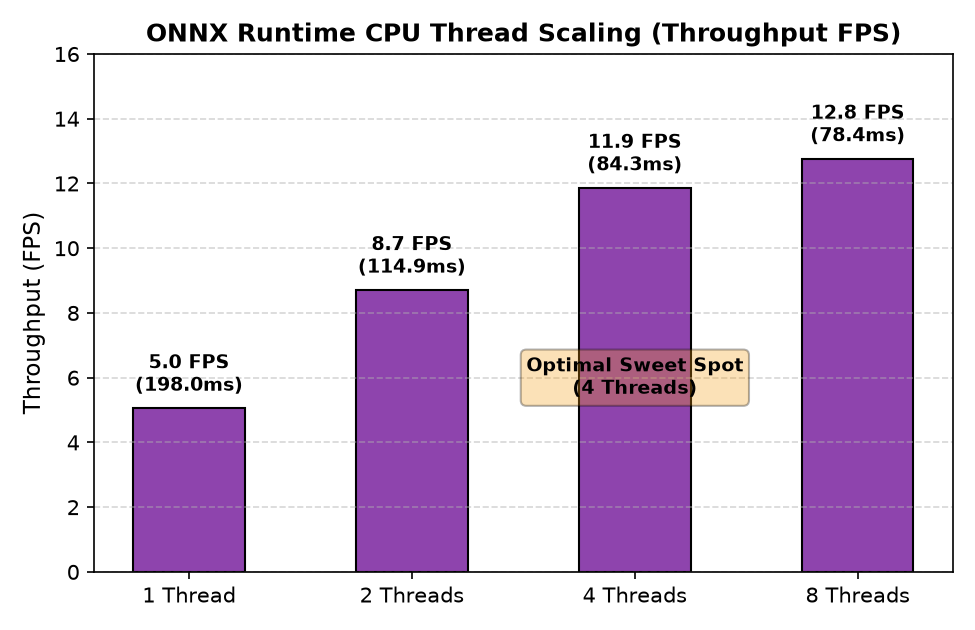
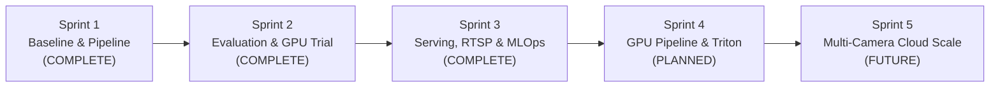

# VISIONSTREAM AI
### Real-Time Computer Vision & Video Analytics

An applied Computer Vision engineering portfolio demonstrating **YOLOv8 object detection, rigorous model evaluation, TensorRT FP16 acceleration, FastAPI model serving, live RTSP video ingestion with GStreamer, ByteTrack multi-object tracking, and lightweight MLOps observability**.

Developed and maintained by **Ahadi Hamijaya**.

---

## 1. Project Overview

VisionStream AI is an applied Computer Vision engineering portfolio designed to bridge the gap between deep learning models and real-world deployment infrastructure.

Rather than presenting theoretical models or synthetic benchmarks, this repository documents practical engineering decisions and empirical results:
- **Model Evaluation Integrity:** Conducting controlled holdout evaluations on 240 images and transparently documenting that a fine-tuned candidate regressed compared to the authoritative YOLOv8 baseline.
- **NVIDIA GPU Acceleration:** Benchmarking an isolated **2.04x speedup (263.27 FPS)** using **TensorRT FP16** on an NVIDIA Tesla T4 GPU.
- **Production-Style Serving:** Containerizing a low-latency **FastAPI model-serving gateway** utilizing PyTorch CPU inference, SHA256 cryptographic model verification, and Prometheus instrumentation.
- **Resilient RTSP Streaming:** Implementing an end-to-end video pipeline using **MediaMTX**, **GStreamer**, and **ByteTrack** with automated disconnect recovery.
- **ONNX Optimization Benchmark:** Evaluating **ONNX Runtime CPU**, revealing a **25x reduction in cold-start latency** (144.65 ms vs 3,616.02 ms) while retaining steady-state throughput parity.

---

## 2. Technology Stack

- **Computer Vision & Tracking:** Ultralytics YOLOv8, OpenCV 4.11, ByteTrack, NumPy
- **Serving & Microservices:** FastAPI, Uvicorn, Pydantic, GStreamer 1.26 (PyGObject), MediaMTX, FFmpeg
- **Optimization & Acceleration:** TensorRT 10.x, ONNX 1.23, ONNX Runtime 1.31, `onnxslim`, CUDA 12.2
- **MLOps & Observability:** Prometheus client (`/metrics`), Python structured JSONL logging, Request UUID tracing
- **Infrastructure & Environment:** Docker, Docker Compose, Linux WSL2, Git

---

## 3. End-to-End System Architecture

```mermaid
flowchart TD
    subgraph Stream_Ingestion ["RTSP Stream Ingestion & Multi-Object Tracking"]
        SRC["Video Stream Source<br/>(FFmpeg / RTSP Camera)"] -->|H.264 over TCP| MTX["MediaMTX RTSP Server<br/>(:8554/live/stream)"]
        MTX -->|TCP Stream| GST["GStreamer Pipeline<br/>(rtspsrc ! rtph264depay ! avdec_h264)"]
        GST -->|Decoded RGB Frames| FP["Frame Processor<br/>(Letterbox 640x640)"]
        FP -->|Batched Frames| DET["YOLOv8 Object Detector<br/>(yolov8n.pt)"]
        DET -->|Detections| TRACK["ByteTrack Association<br/>(Track IDs & Trajectories)"]
        TRACK -->|Stream Telemetry| SLOG["Stream Metrics & Drop Logger"]
    end

    subgraph Serving_Gateway ["FastAPI Model Serving Gateway"]
        API_REQ["Client Application / Ingest Service"] -->|POST Image Payload| API["FastAPI Gateway<br/>(:8085)"]
        API -->|Validate SHA256| REG["Model Registry"]
        API -->|Inference Execution| ENG["PyTorch CPU Engine<br/>(yolov8n.pt)"]
        ENG -->|Boxes & Scores| API
        API -->|Expose Metrics| PROM["Prometheus /metrics"]
        API -->|Structured JSONL| ALOG["logs/serving_access.jsonl"]
    end
```



---

## 4. Key Engineering Achievements

### A. Rigorous Holdout Model Evaluation & Engineering Honesty
- Evaluated the YOLOv8 baseline (`yolov8n.pt`) against a fine-tuned candidate (`best.pt`) on an authoritative 240-image holdout set (972 ground-truth annotated persons).
- **Result:** Baseline YOLOv8n outperformed the fine-tuned candidate (**75.32% vs 69.44% mAP@50**; **51.71% vs 44.25% mAP@50-95**).
- **Engineering Decision:** The fine-tuned candidate was rejected for serving and designated strictly as a research artifact. We transparently document model regression rather than making unvalidated claims.
- *Detailed Evidence:* [Model Evaluation Documentation](docs/evaluation/model-evaluation.md)

### B. NVIDIA Tesla T4 GPU & TensorRT FP16 Acceleration
- Executed controlled benchmarks on an NVIDIA Tesla T4 GPU in a cloud Linux environment.
- **In-Memory Speedup:** TensorRT FP16 achieved a **2.04x speedup** over PyTorch FP32 (**3.79 ms vs 7.72 ms** mean latency; **263.27 FPS vs 129.43 FPS**).
- *Technical Note:* These figures measure in-memory compute passes on preloaded frames, distinct from live streaming network throughput.
- *Detailed Evidence:* [GPU & TensorRT Benchmark](docs/evaluation/gpu-tensorrt-benchmark.md)

### C. Containerized FastAPI Model Serving Gateway
- Engineered a lightweight, thread-safe FastAPI inference gateway running in Docker (`:8085`).
- Uses PyTorch CPU inference with cryptographic SHA256 model weight validation on startup.
- Features `/health/live`, `/health/ready`, Triton-style metadata inspection, and multipart image inference.
- Passed 100% of integration test suites (Gate 2: 9/9 PASS; Gate 4: 12/12 PASS).
- *Detailed Evidence:* [Model Serving Architecture](docs/architecture/model-serving.md)

### D. RTSP Video Streaming with GStreamer & ByteTrack
- Deployed a containerized streaming ecosystem with MediaMTX and GStreamer H.264 decoding.
- **Measured Throughput:** Network ingestion verified at **12.02 FPS**; full downstream analytics (YOLOv8 + ByteTrack) measured at **5.51 FPS** on local CPU.
- Configured real-time frame-dropping backpressure policies (`appsink drop=true max-buffers=2`) to guarantee low latency.
- Verified automatic stream recovery against abrupt RTSP source disconnects.
- *Detailed Evidence:* [Streaming Pipeline Architecture](docs/architecture/streaming-pipeline.md)

### E. ONNX Runtime CPU Benchmark & Multi-Thread Scaling
- Benchmarked `yolov8n.onnx` (Opset 17, 12.26 MB) against PyTorch CPU across 100 measured iterations on AMD Ryzen 7 6800U.
- **Cold-Start Latency:** ONNX Runtime executed its first inference in **144.65 ms** vs PyTorch's **3,616.02 ms** (**25x faster cold start**).
- **Throughput & Tail Latency:** Steady-state throughput remained comparable (PyTorch 11.63 FPS vs ORT 10.84 FPS), while ORT multi-threading yielded lower P95 latency (98.52 ms at 4 threads).
- *Detailed Evidence:* [ONNX Runtime CPU Benchmark](docs/evaluation/onnx-runtime-benchmark.md)

---

## 5. Visual Engineering Evidence

### 5.1 Object Detection & Holdout Model Evaluation
Authentic detection outputs and model validation curves from Sprints 1 and 2:

| YOLOv8 Person Detection Example | YOLOv8 Training Metrics & Loss Curves |
| :---: | :---: |
|  |  |
| *Person bounding boxes and confidence scores on video footage* | *Empirical training loss, precision, recall, and mAP curves* |

| Holdout Evaluation Visual Comparison: Baseline vs Fine-Tuned |
| :---: |
|  |
| *Ground Truth (left) vs Baseline YOLOv8n (center, mAP50 75.32%) vs Fine-Tuned Model (right, mAP50 69.44%)* |

### 5.2 NVIDIA GPU Acceleration & TensorRT Benchmark
Controlled in-memory GPU benchmarks executed on an NVIDIA Tesla T4:

| NVIDIA Tesla T4 Cloud Environment Check | TensorRT FP16 Latency & Throughput Benchmark |
| :---: | :---: |
|  |  |
| *Kaggle/Colab Linux GPU diagnostic: Tesla T4 16GB GDDR6* | *TensorRT FP16 yields 2.04x speedup (3.79ms vs 7.72ms; 263.3 vs 129.4 FPS)* |

### 5.3 FastAPI Model Serving & API Specification
Verified FastAPI container endpoints and OpenAPI 3.1.0 schema:

| FastAPI Serving Gateway & Swagger UI Endpoints |
| :---: |
|  |
| *Interactive Swagger UI (:8085/docs) exposing health probes, model metadata, and inference endpoints* |

### 5.4 ONNX Runtime CPU Benchmark & Thread Scaling
Empirical CPU optimization results on AMD Ryzen 7 6800U (8C/16T):

| ONNX Runtime vs PyTorch CPU (Latency & Cold Start) | ONNX Runtime CPU Thread Scaling (Throughput) |
| :---: | :---: |
|  |  |
| *ONNX achieves 25x faster cold-start (144.6ms vs 3616.0ms) with lower P95 latency* | *Multi-thread scaling peaks at 11.86 FPS at 4 threads (optimal sweet spot)* |

---

## 6. Quantitative Results Summary

<!-- Records-per-page filter: 5, 10, 30, 50, 100, 200, 300, All -->
| Component | Metric | Baseline / PyTorch | Optimized / Accelerated | Delta / Outcome |
| :--- | :--- | :--- | :--- | :--- |
| **Model Accuracy** | Holdout mAP@50 | **75.32%** (Baseline) | 69.44% (Fine-tuned) | Baseline retained; regression documented |
| **GPU Inference** | Mean Latency (T4) | 7.72 ms (PyTorch FP32) | **3.79 ms** (TensorRT FP16) | **2.04x in-memory speedup (263.27 FPS)** |
| **CPU Cold Start** | Initial Latency | 3,616.02 ms | **144.65 ms** (ONNX Runtime) | **25x faster cold start** |
| **CPU Tail Latency**| P95 (4 Threads) | 132.85 ms (PyTorch) | **98.52 ms** (ONNX Runtime) | **Lower P95 latency (-25.8%)** |
| **RTSP Ingestion** | Network Ingest | 12.00 FPS (Target) | **12.02 FPS** (Verified) | Source stream synchronization |
| **Live Tracking** | CPU End-to-End | N/A | **5.51 FPS** (YOLOv8 + ByteTrack) | CPU-bound ceiling; backpressure drop active |

---

## 7. Architecture Decisions & Trade-Offs

- **PyTorch CPU Default vs. ONNX Runtime:** While ONNX Runtime provides a 25x faster cold start, steady-state throughput is equivalent on AMD Ryzen CPUs (~11 FPS). PyTorch CPU is retained as default for developer ergonomics, keeping ONNX ready as a validated optimization artifact for cold-start critical environments.
- **Local FastAPI vs. Triton Inference Server:** Triton was assessed and deferred for the local AMD CPU environment. Running Triton CPU backend in Docker adds ~1.5 GB memory overhead without compute acceleration. Triton is reserved for multi-GPU cloud environments.
- **Real-Time Video Latency vs. Frame Retention:** In surveillance streams, fresh frames take precedence over backlog processing. Older frames are safely dropped via GStreamer `appsink` when inference falls behind source frame rates.
- *Detailed Evidence:* [Architecture Decision Records (ADRs)](docs/engineering/architecture-decisions.md)

---

## 8. Repository Structure

```text
visionstream-ai/
├── data/
│   └── models/                      # Authoritative model storage (SHA256 verified)
│       └── optimized/onnx/          # Exported ONNX runtime artifacts
├── docker/
│   ├── Dockerfile                   # Base CPU computer vision image
│   ├── Dockerfile.serving           # FastAPI model serving gateway image
│   ├── Dockerfile.streaming         # GStreamer & streaming ingest image
│   └── mediamtx.yml                 # MediaMTX RTSP broker configuration
├── docs/
│   ├── architecture/                # System, serving, and streaming architecture docs
│   ├── evaluation/                  # Model holdout, TensorRT, and ONNX benchmarks
│   ├── engineering/                 # MLOps observability and ADRs
│   └── project/                     # Roadmap and sprint history
├── eval_tools/                      # Isolated evaluation and benchmark engines
├── images/
│   └── portfolio/                   # Approved visual engineering portfolio assets
├── notebooks/                       # Google Colab & Kaggle GPU experiment notebooks
├── reports/                         # Authoritative audit reports and benchmark data
├── src/
│   ├── serving/                     # FastAPI app, inference engine, schemas, metrics
│   ├── streaming/                   # RTSP client, GStreamer ingest, ByteTrack
│   ├── detector.py                  # Core YOLOv8 inference wrapper
│   └── pipeline.py                  # Offline pipeline coordinator
├── docker-compose.serving.yml       # Model serving service compose file
├── docker-compose.streaming.yml     # MediaMTX + RTSP streaming compose file
├── requirements.txt                 # Project dependencies
└── README.md                        # Portfolio documentation landing page
```

---

## 9. Reproducibility & Quickstart

### Prerequisites
- Docker Desktop with WSL2 (Linux containers)
- Python 3.11+ (for local inspection)

### A. Run Model Serving Gateway
```bash
# Start FastAPI serving container on port 8085
docker compose -f docker-compose.serving.yml up -d

# Verify readiness probe
curl http://localhost:8085/health/ready

# Inspect in-process Prometheus metrics
curl http://localhost:8085/metrics
```

### B. Run RTSP Streaming Pipeline
```bash
# Start MediaMTX, RTSP publisher, and GStreamer ingestion
docker compose -f docker-compose.streaming.yml up -d

# View live streaming ingestion logs
docker compose -f docker-compose.streaming.yml logs -f streaming-ingest
```

---

## 10. Limitations & Current Scope

- **CPU-Bound End-to-End Analytics:** Full analytics (YOLOv8n + ByteTrack) operates at **5.51 FPS** on local CPU. True 30 FPS video analytics requires dedicated NVIDIA GPU acceleration (e.g., DeepStream/TensorRT).
- **Single Stream Scope:** Multi-camera horizontal scalability has been designed architecturally but not benchmarked across multi-stream hardware.
- **REST Inference Protocol:** The custom API employs Triton-style route conventions but uses multipart image payloads rather than the binary KServe v2 tensor protocol.
- **Standalone Telemetry:** Observability uses an in-process Prometheus exposition endpoint (`/metrics`) and structured JSONL logs, without an external multi-node telemetry cluster.

---

## 11. Project Roadmap



---

## 12. Author Profile

**Ahadi Hamijaya**  
*Senior IT Project Manager & Computer Vision Engineer*  
- **Background:** Proven track record in IT project management and telecommunications infrastructure, coupled with hands-on expertise in applied Computer Vision and MLOps.
- **Specializations:** YOLO object detection, inference optimization (TensorRT / ONNX Runtime), video streaming pipelines (GStreamer / RTSP), and production ML model serving.
- **GitHub:** [https://github.com/kangdidipro](https://github.com/kangdidipro)
