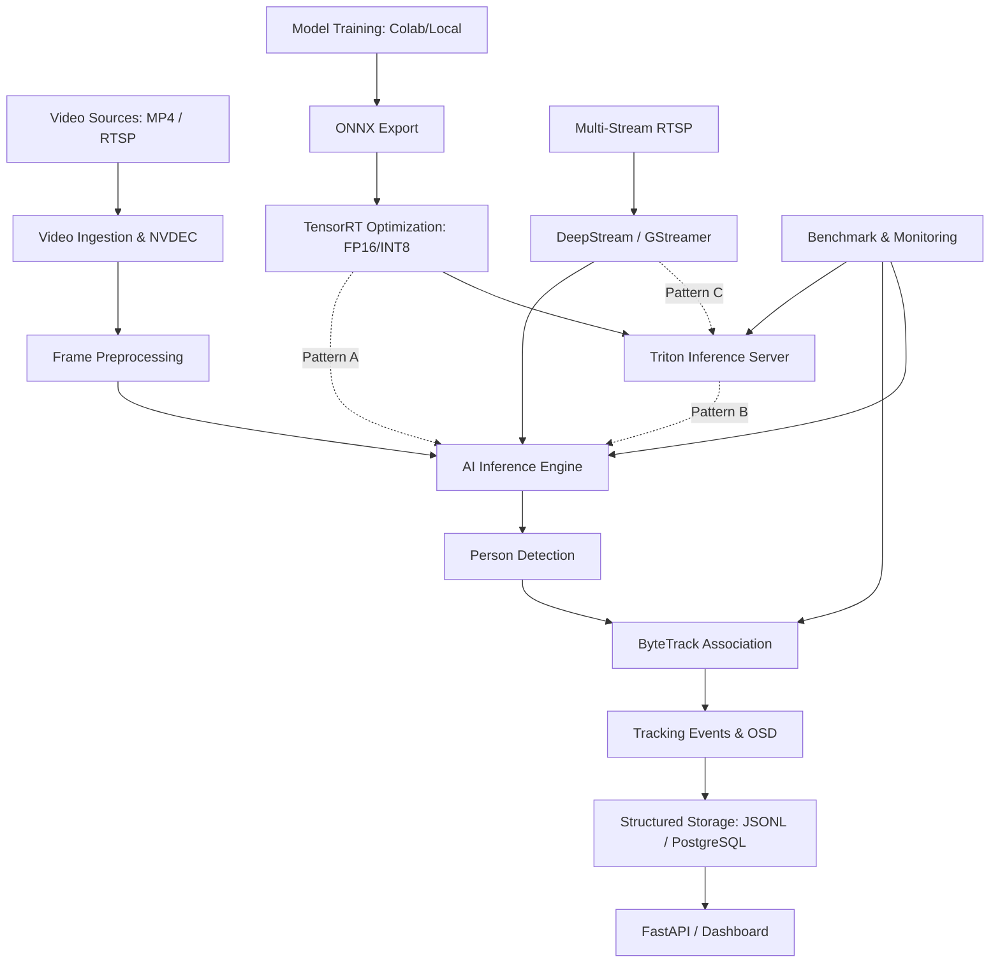

# VISIONSTREAM AI
## MASTER BLUEPRINT
### Real-Time Multi-Stream Computer Vision & GPU Inference Platform

**Document Version:** 1.0.1  
**Date:** November 5, 2026  
**Document Type:** Master Project Blueprint (Architecture Review Corrections)  
**Project Classification:** Independent Professional Portfolio  
**Development Methodology:** Gate-Based, Evidence-Driven Engineering  
**Primary Development Tool:** Google Antigravity  
**Source Control:** GitHub  
**Canonical File Location:** `C:\my-app\visionstream-ai\docs\architecture\MASTER-BLUEPRINT.md`

---

# 1. PROJECT IDENTITY

## 1.1 Project Name

**VisionStream AI**

## 1.2 Project Description

VisionStream AI is an open, modular computer vision platform designed for real-time person detection, multi-object tracking, multi-stream video processing, and NVIDIA GPU inference optimization.

The platform demonstrates practical engineering capabilities across the computer vision and NVIDIA ecosystem, from model development and inference optimization to video streaming, serving, monitoring, and deployment.

## 1.3 Project Mission

Build a technically credible and reproducible Computer Vision Engineering Platform that demonstrates:

- Person Detection.
- Multi-Object Tracking.
- Multi-Stream Video Processing.
- NVIDIA GPU Acceleration.
- TensorRT Optimization.
- DeepStream and GStreamer Integration.
- Triton Inference Serving.
- Performance Benchmarking.
- Structured Detection Data Management.

## 1.4 Project Objectives

1. Demonstrate practical knowledge of modern computer vision architecture.
2. Develop a working person detection and tracking application.
3. Gain hands-on experience with NVIDIA GPU technologies.
4. Understand the complete inference pipeline from video input to structured output.
5. Establish measurable performance benchmarks.
6. Produce reproducible technical evidence.
7. Publish a professional portfolio on GitHub.

## 1.5 Portfolio Positioning

VisionStream AI is an independent professional engineering project.

It must not contain:
- Employer or client names.
- Proprietary application references.
- Confidential business information.
- Unrelated project names.
- Third-party branding presented as project ownership.

---

# 2. DEVELOPMENT PRINCIPLES

Five principles govern the entire project.

### 2.1 Professional Portfolio First

Every major component must have adequate documentation, source code, configuration, test evidence, and reproducibility instructions.

### 2.2 Technology-Driven

The project prioritizes practical experience with Computer Vision and NVIDIA technologies.

### 2.3 Evidence-Based Engineering

Every claimed capability must be supported by technical evidence:

- Source code.
- Configuration.
- Test results.
- Execution logs.
- Benchmark measurements.
- Video output.
- Architecture documentation.

### 2.4 Modular Architecture

Components should be independently testable and replaceable without requiring a complete platform redesign.

### 2.5 Resource-Efficient Development

Use the available laptop for Docker-isolated development, Google Colab for suitable GPU experiments, and NVIDIA Cloud GPU infrastructure only when genuinely required.

No paid cloud resources may be provisioned without explicit user approval.

---

# 3. FUNCTIONAL SCOPE

## 3.1 Core Functional Scope

| Capability | Description |
|---|---|
| Person Detection | Detect human objects in video frames |
| Bounding Box | Draw bounding boxes around detected people |
| Tracking ID | Assign temporary tracking IDs |
| Multi-Object Tracking | Maintain object associations across frames |
| Multi-Stream | Process independent video streams |
| RTSP Input | Receive live video streams |
| GPU Inference | Execute inference using NVIDIA GPU |
| Model Optimization | Convert and optimize models |
| Inference Serving | Serve models through Triton |
| Structured Logging | Store detection and tracking events |
| Benchmarking | Measure performance and tracking quality |

## 3.2 Explicitly Excluded Scope

The following are not part of this project:

- Face Recognition.
- Permanent human identity recognition.
- Cross-camera Person Re-Identification.
- Tracking a person's identity between different rooms.
- Biometric identification.
- Identity matching across independent cameras.

A tracking ID represents a temporary object track within a particular stream and tracking session.

It is not a person's permanent identity.

## 3.3 Functional Acceptance Philosophy

The platform must demonstrate that:

1. A person can be detected in actual video frames.
2. Bounding boxes are correctly generated.
3. Tracking IDs are assigned.
4. Tracking associations persist across consecutive frames when possible.
5. Multiple people can be tracked simultaneously.
6. Independent video streams maintain independent tracking states.
7. Detection and tracking results can be recorded and inspected.

---

# 4. TARGET SYSTEM ARCHITECTURE

## 4.1 Logical Architecture

The platform is organized into seven major layers.

### Layer 1 — Video Input

Responsibilities:
- MP4 video input.
- RTSP stream input.
- Video file validation.
- Stream configuration.
- Frame acquisition.

Technologies:
- OpenCV.
- FFmpeg.
- GStreamer.

### Layer 2 — Video Processing

Responsibilities:
- Frame decoding.
- Resolution handling.
- Frame preprocessing.
- Timestamp management.
- Stream identification.

Technologies:
- OpenCV.
- GStreamer.
- NVIDIA NVDEC.

### Layer 3 — AI Inference

Responsibilities:
- Person detection.
- Model execution.
- Confidence filtering.
- Bounding box generation.

Technologies:
- PyTorch.
- YOLO.
- ONNX.
- TensorRT.

### Layer 4 — Object Tracking

Responsibilities:
- Detection-to-track association.
- Temporary tracking ID assignment.
- Track lifecycle management.
- Tracking state isolation.

Technologies:
- ByteTrack.
- Kalman Filter.
- IoU-based association.

### Layer 5 — Inference Serving & Scheduling

Responsibilities:
- Model serving.
- Inference request handling.
- Batch scheduling.
- Multi-stream inference coordination.

Technologies:
- NVIDIA Triton Inference Server.
- NVIDIA DeepStream.
- GStreamer.

### Layer 6 — Data & Application

Responsibilities:
- Detection event storage.
- Tracking event storage.
- Stream management.
- Configuration management.
- Dashboard and result visualization.

Technologies:
- Python.
- FastAPI.
- PostgreSQL.
- Docker.

### Layer 7 — Monitoring & Benchmarking

Responsibilities:
- Throughput monitoring.
- Latency measurement.
- GPU utilization.
- Tracking quality evaluation.
- Operational monitoring.

Technologies:
- Python benchmarking tools.
- NVIDIA GPU monitoring utilities.
- Prometheus/Grafana if justified by implementation requirements.

## 4.2 Logical Processing Flow & Architectural Patterns

The platform supports modular deployment patterns rather than requiring all components to be monolithically active at once:

```
[Standard Offline/Edge Flow]
Video Source → Frame Decoder → Preprocessing → AI Inference → Person Detection → ByteTrack → Structured Events → Storage → Dashboard.

[Model Optimization Path]
Model Training → ONNX Export → TensorRT Engine Generation → Benchmarking.
```

### Supported NVIDIA Serving & Analytics Patterns:
1. **Pattern A: NVIDIA DeepStream + TensorRT Engine**  
   High-throughput hardware-accelerated video analytics pipeline where NVDEC, GStreamer, and TensorRT inference run tightly coupled inside the DeepStream pipeline.
2. **Pattern B: Application / Video Pipeline + Triton Inference Server**  
   Decoupled microservice architecture where video ingest/tracking runs in Python/C++ workers and offloads batched model inference requests over gRPC/HTTP to a standalone Triton server.
3. **Pattern C: DeepStream + Triton Server Backend Integration**  
   Enterprise multi-stream pattern where DeepStream uses the `nvinferserver` GStreamer plugin to route frames through Triton for dynamic scheduling, multi-model pipelines, or ensemble serving.

Components are modular and independently testable; the platform does not assume all technologies must be deployed together in every sprint.

## 4.3 Target Architecture Diagram



The diagram describes the intended target architecture, not a claim that every component has already been implemented.

---

# 5. TECHNOLOGY STACK

## 5.1 Core Development

| Component | Technology | Purpose |
|---|---|---|
| Programming | Python | Application development |
| Containerization | Docker | Runtime isolation |
| Orchestration | Docker Compose | Local development |
| Computer Vision | OpenCV | Image/video processing |
| Video Codec | FFmpeg | Video encoding and decoding |
| Detection | YOLO | Person detection |
| Tracking | ByteTrack | Multi-object tracking |
| API | FastAPI | Application interface |
| Database | PostgreSQL | Structured data storage |
| Version Control | Git / GitHub | Source management |

## 5.2 Model Development

| Technology | Purpose |
|---|---|
| PyTorch | Model training and inference |
| YOLO | Detection architecture |
| ONNX | Model interoperability |
| Google Colab | GPU-based experiments |
| Evaluation tools | mAP, IDF1, HOTA, and confusion matrix |

## 5.3 NVIDIA Ecosystem

| Technology | Purpose |
|---|---|
| CUDA | GPU computing |
| TensorRT | Inference optimization |
| FP16 | Half-precision inference |
| INT8 | Quantized inference |
| DeepStream | Video analytics pipeline |
| GStreamer | Media streaming pipeline |
| NVDEC | Hardware video decoding |
| Triton | Model serving |
| NVIDIA GPU monitoring | GPU resource measurement |

Technology versions must be pinned and verified within their respective implementation environments. Compatibility must be established before integrating components.

---

# 6. DEVELOPMENT ENVIRONMENTS & DOCKER ISOLATION POLICY

## 6.1 Docker Isolation Policy

A strict containerization and isolation policy applies across all development environments:

1. **Host Environment Isolation (Windows 11):**  
   - The Windows host machine (`LAPTOP-62621JIA`) is strictly limited to running Docker Desktop, Google Antigravity, Git, authoring documentation, and accessing bind-mounted directories.  
   - **No global Windows Python installation or project `.venv` is permitted.**  
   - No Python packages may be installed directly on the Windows operating system.  
   - Windows environment variables, system PATH, and system configurations must not be altered for project runtimes.
2. **Containerized Application Runtime:**  
   - All application runtimes, Python interpreters, computer vision libraries, PyTorch, and tracker dependencies must execute exclusively inside Docker containers.  
   - File persistence between the container and host is managed strictly through explicit Docker volume mounts (`src`, `data/inputs`, `data/outputs`, `data/models`, `logs`, `reports`).
3. **NVIDIA Cloud GPU Environment:**  
   - All cloud GPU workloads (TensorRT, DeepStream, Triton) must execute inside containerized NVIDIA Docker environments (NVIDIA Container Toolkit / NGC base containers).  
   - Host GPU VMs must remain clean and unpolluted by manual global package installations.
4. **Google Colab Environment:**  
   - Colab notebooks used for training and dataset evaluation must execute within their self-contained, isolated ephemeral runtime instances.

## 6.2 Local Development — ASUS Zenbook

Machine: `LAPTOP-62621JIA`.

Known hardware:
- AMD Ryzen 7 6800U (Zen 3+, AVX2 supported, no AVX-512/VNNI).
- 16 GB LPDDR5 RAM.
- AMD Radeon 680M integrated GPU.
- No NVIDIA GPU.

Responsibilities:
- Source code development.
- Docker-based application runtime.
- CPU-based detection and tracking.
- Unit and integration tests.
- Documentation.
- Video sample inspection.
- Git operations.

## 6.3 Google Colab

Responsibilities:
- Model training experiments.
- Dataset preparation and validation.
- Model evaluation against ground-truth benchmarks.
- ONNX export.
- GPU experiments where compatible.

## 6.4 NVIDIA Cloud GPU VM

Responsibilities:
- Actual CUDA GPU execution.
- TensorRT FP32 / FP16 / INT8 engine generation and calibration.
- DeepStream pipeline execution.
- GStreamer GPU pipeline.
- NVDEC hardware decoding.
- Triton GPU model serving.
- Multi-stream RTSP benchmarking.

Cloud resources require explicit approval before provisioning or incurring costs.

---

# 7. PROJECT DEVELOPMENT ROADMAP & SPRINT MAPPING

To maintain clear operational governance, the nine Master Phases are mapped directly to operational Sprints:

| Master Phase | Operational Sprint | Focus Area | Operational Status |
|---|---|---|---|
| **Phase 0** — Environment & Hardware Assessment | **Sprint 0** | Hardware Audit & Feasibility | **PASS** |
| **Phase 1** — Project Architecture & Repository Setup | **Sprint 0A / Architecture Gate** | Blueprint & Docker Baseline | **PASS / ESTABLISHED** |
| **Phase 2** — Person Detection & Tracking | **Sprint 1** | YOLOv8n + ByteTrack Pipeline | **FUNCTIONAL PASS (Formal Gate Approval PENDING)** |
| **Phase 3** — Model Training & Evaluation | **Sprint 2** | Custom Training & Ground-Truth Eval | **HOLD (Awaiting Sprint 1 Closure)** |
| **Phase 4** — NVIDIA TensorRT Optimization | **Sprint 3** | ONNX Export & TensorRT Engines | **PLANNED** |
| **Phase 5** — DeepStream & Multi-Stream Processing | **Sprint 4** | GPU Pipelines & Multi-Stream RTSP | **PLANNED** |
| **Phase 6** — Triton & Inference Scheduling | **Sprint 5** | Model Serving & Dynamic Batching | **PLANNED** |
| **Phase 7** — Database, Dashboard & Deployment | **Sprint 6** | FastAPI, PostgreSQL & Dashboard | **PLANNED** |
| **Phase 8** — Benchmark & Portfolio Release | **Final Release** | Documentation, Review & Release | **PLANNED** |

---

## Detailed Phase Breakdown

### Phase 0 — Environment & Hardware Assessment (Sprint 0)
- **Objective:** Determine local and cloud execution feasibility.
- **Deliverables:** Hardware inventory, software inventory, GPU capability assessment, Docker feasibility, cloud GPU strategy.
- **Status:** **PASS** (Terdokumentasi pada `reports/SPRINT-00-ENVIRONMENT-ASSESSMENT.md`).

### Phase 1 — Project Architecture & Repository Setup (Sprint 0A / Architecture Gate)
- **Objective:** Establish the project structure, technical architecture, source control, Docker conventions, and engineering documentation.
- **Deliverables:** Master Blueprint, architecture documentation, Dockerfile, docker-compose.yml, development guidelines.
- **Status:** **PASS / ESTABLISHED** (`docs/architecture/MASTER-BLUEPRINT.md`).

### Phase 2 — Person Detection & Tracking (Sprint 1)
- **Objective:** Build a working person detection and tracking pipeline.
- **Deliverables:** YOLO person detection, ByteTrack integration, tracking ID assignment, annotated video output, structured logs, CPU benchmark.
- **Status Reconciliation:**
  - *Functional Implementation:* **PASS** (Container builds, CPU PyTorch, OpenCV, ByteTrack operational).
  - *Original Video Test (`people-detection.mp4`):* **PASS** (Documented in `reports/SPRINT-01-VIDEO-TEST-EVIDENCE-AUDIT.md`).
  - *Additional CCTV Video Test (`people-detection-faces.mp4`):* **PASS** (Documented in `reports/SPRINT-01-ADDITIONAL-VIDEO-TEST-RESULTS.md`, 460 frames, 4,667 detections).
  - *Technical Documentation Review:* **COMPLETED**.
  - *Formal Sprint 1 Approval:* **PENDING** until explicitly approved by the human project owner.

### Phase 3 — Model Training & Evaluation (Sprint 2)
- **Objective:** Develop a reproducible model training and evaluation workflow with rigorous ground-truth validation.
- **Activities:** Dataset selection, dataset validation, train/val/test split, model training (Colab/GPU), hyperparameter experiments, evaluation against ground-truth labels, ONNX export.
- **Deliverables:** Dataset documentation, training configuration, training logs, model weights, evaluation report (mAP50, mAP50-95, precision, recall, confusion matrix).
- **Status:** **HOLD** (Awaiting formal user authorization).

### Phase 4 — NVIDIA TensorRT Optimization (Sprint 3)
- **Objective:** Optimize inference performance using NVIDIA TensorRT.
- **Activities:** ONNX validation, TensorRT engine generation, FP32 baseline, FP16 optimization, INT8 calibration, accuracy/throughput comparison.
- **Deliverables:** ONNX model, TensorRT FP32/FP16/INT8 engines, benchmark report, accuracy and performance comparison.

### Phase 5 — DeepStream & Multi-Stream Processing (Sprint 4)
- **Objective:** Develop GPU-accelerated multi-stream video processing.
- **Activities:** DeepStream setup, GStreamer pipeline, RTSP input, NVDEC hardware decoding, multi-stream detection and tracking, per-stream resource management.
- **Deliverables:** Multi-stream application, RTSP configuration, DeepStream pipeline, per-stream tracking results, multi-stream benchmark.

### Phase 6 — Triton & Inference Scheduling (Sprint 5)
- **Objective:** Implement model serving and inference scheduling.
- **Activities:** Triton Inference Server setup, model repository configuration, model serving, dynamic batching evaluation, concurrent request monitoring, scheduling experiments.
- **Deliverables:** Triton configuration, model repository, inference API, serving benchmark, scheduling evaluation.

### Phase 7 — Database, Dashboard & Deployment (Sprint 6)
- **Objective:** Build the application and data management layer.
- **Activities:** FastAPI service, PostgreSQL integration, stream configuration, detection event storage, tracking event storage, dashboard visualization, deployment configuration.
- **Deliverables:** Application API, database schema, dashboard, Docker deployment, operational documentation.

### Phase 8 — Benchmark & Portfolio Release (Final Release)
- **Objective:** Produce a complete, reproducible professional portfolio.
- **Activities:** Final regression tests, performance evaluation, architecture review, security/license review, documentation review, GitHub repository preparation, demo video production.
- **Deliverables:** Final source code, README, architecture diagrams, benchmark reports, test evidence, demonstration videos, deployment instructions, portfolio release.

---

# 8. PERFORMANCE & QUALITY METRICS & GROUND-TRUTH REQUIREMENTS

## 8.1 Ground-Truth Evaluation Requirements

To maintain technical credibility, model and tracking evaluation must adhere to strict ground-truth standards:

1. **Object Detection Ground-Truth Requirements:**  
   - Evaluating detection quality metrics (Precision, Recall, mAP@50, mAP@50-95, PR-curves) **strictly requires verified human-annotated ground-truth bounding boxes** on a dedicated validation/test dataset.  
   - Detection metrics cannot be calculated from unannotated raw video streams or model self-predictions.
2. **Multi-Object Tracking Ground-Truth Requirements:**  
   - Evaluating formal tracking benchmark metrics (IDF1, HOTA, Multiple Object Tracking Accuracy [MOTA], ID Switches, Track Fragmentation) **strictly requires ground-truth object track IDs across consecutive frames** (such as MOTChallenge-style annotations).  
   - In the absence of ground-truth tracking annotations on arbitrary CCTV video, tracking reports must clearly state that metrics represent *operational tracking statistics* (e.g., active track counts, observed track duration, and bounding box scale change) rather than formal benchmark accuracy metrics.
3. **Dataset Provenance & Licensing:**  
   - All evaluation and training datasets must possess documented origins, publisher attribution, and explicit open licenses (e.g., CC-BY, MIT, or public academic research licenses).

## 8.2 Detection Metrics (with Ground Truth)
- Precision & Recall.
- Mean Average Precision (mAP@50 and mAP@50-95).
- Confusion Matrix & F1-Score curve.
- Confidence score distribution.

## 8.3 Tracking Metrics (Operational vs. Benchmark)
- **Operational Tracking Metrics (Arbitrary Video):** Number of unique assigned IDs, track continuity lifespan (min/mean/max frames), frames with multi-person tracking, bounding box scale expansion.
- **Formal Benchmark Metrics (Annotated Datasets only):** IDF1, ID switches, Track fragmentation, HOTA, MOTA.

## 8.4 System & Multi-Stream Performance Metrics
- Pipeline Throughput (FPS) vs. Native Video FPS.
- Model Forward-Pass Latency (ms/frame).
- End-to-End Processing Latency (ms/frame).
- Number of concurrent streams.
- Per-stream throughput and latency.
- GPU utilization, GPU memory usage, CPU utilization, and system RAM usage.

Benchmark reports must explicitly distinguish model inference latency, pipeline latency, and total wall-clock execution time.

---

# 9. VIDEO SAMPLE & DATASET STRATEGY

## 9.1 Current Video Samples

| Sample Filename | Resolution & FPS | Purpose | Evidence & Audit Status |
|---|---|---|---|
| `people-detection.mp4` | 768x432 @ 12 FPS (596 frames) | Baseline test sample | **PASS** (Audited in `reports/SPRINT-01-VIDEO-TEST-EVIDENCE-AUDIT.md`) |
| `people-detection-faces.mp4` | 1920x1080 @ 23.98 FPS (460 frames) | High-density 1080p CCTV test | **PASS** (Audited in `reports/SPRINT-01-ADDITIONAL-VIDEO-TEST-RESULTS.md`, 4,667 detections) |

## 9.2 Future Dataset Requirements

Future training and evaluation datasets (Phase 3 / Sprint 2) must include:
- Single-person and multi-person pedestrian scenes.
- Crossing paths, varied distances, and lighting variations.
- Partial and momentary occlusions.
- Fully verified bounding-box ground-truth annotations.
- Explicit usage rights and public licenses.

## 9.3 Privacy Boundaries

Visible faces in video footage are permitted as natural visual context in public scenes. However, VisionStream AI **strictly does not perform face detection, facial recognition, biometric extraction, or individual identity tracking**.

---

# 10. GITHUB & ASSET MANAGEMENT RULES

To maintain clean repository hygiene and adhere to copyright and security best practices:

1. **Security & Secrets Exclusion:**  
   - No API keys, cloud credentials, tokens, SSH keys, or private configuration files (`.env`) may ever be committed.  
   - Sensitive files must be explicitly listed in `.gitignore`.
2. **Binary & Asset Management Policy:**  
   - Raw video input files (`data/inputs/*`), annotated output videos (`data/outputs/*`), binary model checkpoints (`data/models/*`), and temporary run logs (`logs/*`) must **never be committed directly to Git**.  
   - Only `.gitkeep` placeholders or lightweight download/acquisition scripts should be committed to Git.
   - Large assets required for public portfolio demonstration must be hosted via external storage links (e.g., GitHub Releases, Google Drive, or Hugging Face) or tracked via Git LFS only when strictly justified and approved.
3. **Licensing and Attribution:**  
   - Every third-party asset (videos, pretrained weights, open-source libraries) must be documented with its original URL, author/publisher, license type, and attribution statement.
4. **Target Logical Repository Structure:**
```text
visionstream-ai/
│
├── src/                # Modular Python application code
├── configs/            # Configuration schemas (YAML/Pydantic)
├── data/               # Bind-mounted directory (ignored in Git)
│   ├── inputs/         # Input videos (.gitkeep)
│   ├── outputs/        # Output videos (.gitkeep)
│   └── models/         # Model weights (.gitkeep)
├── logs/               # Structured detection logs (.gitkeep)
├── tests/              # Automated test suites
├── benchmarks/         # Benchmark scripts and result data
├── docker/             # Dockerfile and container scripts
├── docs/               # System documentation and blueprints
│   └── architecture/   # Architecture blueprints and diagrams
├── reports/            # Markdown sprint reports and changelogs
├── docker-compose.yml  # Container service definitions
├── requirements.txt    # Pinned Python package dependencies
├── .gitignore          # Git exclusion rules
├── .dockerignore        # Docker build context exclusions
└── README.md           # Public portfolio entrypoint
```

---

# 11. ENGINEERING GOVERNANCE & APPROVAL GATES

Every phase must follow an 8-step gate-based process:

1. **Architecture Investigation:** Audit existing code, environment constraints, and dependencies.
2. **Implementation Planning:** Define scope, acceptance criteria, and execution plan.
3. **Development:** Implement features inside isolated Docker containers.
4. **Technical Verification:** Execute automated tests and verify integrity.
5. **Regression Testing:** Ensure existing baseline functionality remains unbroken.
6. **Human Review & Approval:** Present empirical evidence for user review.
7. **Phase Closure:** Finalize sprint documentation and sign off.
8. **Next Phase Authorization:** Await explicit human instruction before proceeding.

No phase is considered complete merely because code has been generated.

---

# 12. PROJECT RISKS & MITIGATION STRATEGY

| Risk Area | Specific Constraint | Mitigation Strategy |
|---|---|---|
| **GPU Availability** | No local NVIDIA GPU on laptop (AMD 680M only) | Local CPU-only Docker for development; Google Colab for training; approved NVIDIA Cloud GPU VM for TensorRT/DeepStream/Triton. |
| **Instruction Sets** | AMD Ryzen 7 6800U lacks AVX-512 / VNNI | Focus CPU optimizations on AVX2 SIMD; rely on CUDA GPUs for high-throughput deployment. |
| **Throughput Scaling** | 1080p processing drops to ~8 FPS on CPU | Transition high-resolution multi-stream pipelines to NVIDIA GPU acceleration (Phase 4 & 5). |
| **Cloud Expenditure** | Unmonitored cloud GPU instances incur costs | Strict policy: No paid cloud instances may be provisioned without prior explicit user authorization. |
| **Dataset Governance** | Unclear redistribution rights on video samples | Verify CC-BY / Pexels licenses before acquisition; document provenance in reports. |
| **Scope Creep** | Temptation to add face recognition or biometric Re-ID | Explicitly exclude permanent identity tracking in functional specifications. |

---

# 13. CURRENT PROJECT BASELINE & ACCEPTANCE STATE

*Baseline as of November 5, 2026:*

## Completed Milestones
- [x] **Sprint 0 (Phase 0):** Environment Assessment (Ryzen 7 6800U, 16 GB RAM, Docker verified).
- [x] **Sprint 0A (Phase 1):** Docker-First architecture established; Master Blueprint v1.0.1 published.
- [x] **Sprint 1 (Phase 2) Implementation:** YOLOv8n + ByteTrack pipeline operational.
- [x] **Baseline Video Execution:** `people-detection.mp4` verified (596 frames, 12.28 FPS, 7 tracks).
- [x] **Additional CCTV Acquisition:** `people-detection-faces.mp4` validated and acquired (1080p, SHA-256 verified).
- [x] **Additional CCTV Execution:** `people-detection-faces.mp4` verified (460 frames, 4,667 detections, 99 tracks, 8.08 FPS, supported by `reports/SPRINT-01-ADDITIONAL-VIDEO-TEST-RESULTS.md`).
- [x] **Integrity Audit:** Baseline video preserved unchanged; test suite automated and passing.

## Current Acceptance State Table

| Milestone / Gate | Operational Status | Governing Evidence Document |
|---|---|---|
| **Phase 0 / Sprint 0** | **PASS** | `reports/SPRINT-00-ENVIRONMENT-ASSESSMENT.md` |
| **Phase 1 / Sprint 0A** | **PASS** | `docs/architecture/MASTER-BLUEPRINT.md` |
| **Phase 2 / Sprint 1 (Functional)** | **PASS** | `reports/SPRINT-01-PERSON-DETECTION-TRACKING.md` |
| **Phase 2 / Sprint 1 (Technical Verification)** | **PASS** | `reports/SPRINT-01-TECHNICAL-VERIFICATION.md` |
| **Phase 2 / Sprint 1 (Video Audit)** | **PASS** | `reports/SPRINT-01-VIDEO-TEST-EVIDENCE-AUDIT.md` |
| **Phase 2 / Sprint 1 (Additional CCTV Video)** | **PASS** | `reports/SPRINT-01-ADDITIONAL-VIDEO-TEST-RESULTS.md` |
| **Sprint 1 Formal Gate Approval** | **PENDING** | **Awaiting Explicit Human Project Owner Approval** |
| **Phase 3 / Sprint 2 (Model Training & Eval)** | **HOLD** | **Awaiting Sprint 1 Closure & Authorization** |

---

# 14. PROJECT COMPLETION CRITERIA

VisionStream AI can be considered portfolio-ready when:

1. Person detection and tracking work reliably.
2. Multiple streams can be processed independently.
3. NVIDIA GPU acceleration is demonstrated on compatible hardware.
4. TensorRT optimization is measured and documented.
5. DeepStream and GStreamer integration is demonstrated.
6. Triton model serving is operational.
7. Detection and tracking events are stored and accessible.
8. Benchmarks are reproducible.
9. Architecture and implementation are documented.
10. GitHub repository is publishable.
11. Demonstration material is available.
12. Technical claims are supported by evidence.

---

# 15. MASTER BLUEPRINT GOVERNANCE

This document is the primary architectural and operational reference for VisionStream AI.

All future implementation prompts, sprint plans, architecture decisions, and technical reports must remain consistent with this blueprint.

Changes to the project mission, technology strategy, functional scope, or development roadmap must be documented as blueprint revisions.

**Version 1.0.1 — Master Blueprint Review Corrections**  
**Project:** VisionStream AI  
**Mission:** Build a modular, reproducible, GPU-accelerated Computer Vision Engineering Platform.  
**Development Philosophy:** Evidence-Based, Modular, Resource-Efficient, and Portfolio-Ready.
