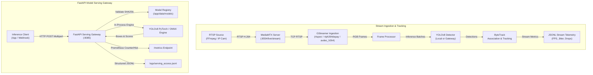

# System Architecture Overview

VisionStream AI is designed as a modular, decoupled computer vision platform capable of handling real-time video stream ingestion, scalable model serving, and telemetry observability.

## 1. High-Level Architecture

The system decouples edge/stream processing from model serving and analytics:

## 2. Key Architectural Tenets

1. **Decoupled Video Pipeline vs. Inference Serving:**  
   Streaming ingestion operates autonomously with resilient reconnect mechanics and backpressure drop policies. The model serving layer can run standalone or edge-colocated.
2. **Defensive Model Validation:**  
   Model weights are cryptographically verified via SHA256 hashes prior to runtime initialization to prevent silent drift or corrupted weight substitution.
3. **Hardware Agnostic Design:**  
   The system provides optimized inference paths across:
   - **Local CPU:** Multi-threaded PyTorch CPU & ONNX Runtime (Ryzen 7 6800U).
   - **Accelerated Cloud GPU:** NVIDIA Tesla T4 with TensorRT FP16 execution.
4. **Structured Telemetry First:**  
   Every transaction carries a trace UUID, measured latency breakdown (preprocess, inference, postprocess), and outputs to structured JSONL and Prometheus gauges.
