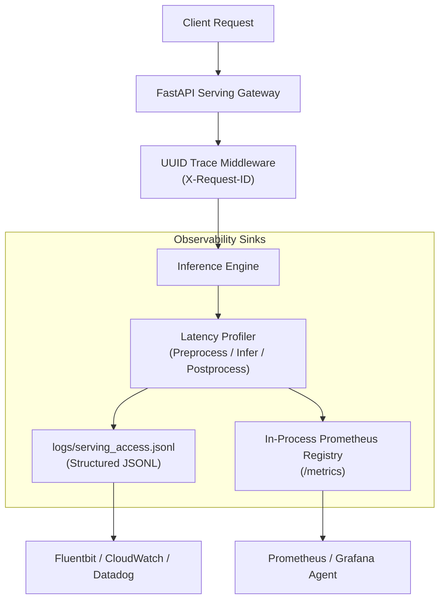

# MLOps & Observability

## 1. Overview

VisionStream AI incorporates lightweight, zero-dependency MLOps patterns designed to provide comprehensive operational visibility without requiring multi-node telemetry clusters.

## 2. Telemetry Architecture

## 3. Implemented Capabilities

1. **Request Tracing:**  
   Every inference transaction generates or accepts an `X-Request-ID` UUID, tracking payloads through preprocessing, inference, and serialization.
2. **Structured JSONL Access Logs:**  
   Events are logged with ISO-8601 timestamps, model name, request UUID, image dimensions, box count, and nanosecond/millisecond timing splits.
3. **Prometheus Metrics Endpoint:**  
   - Counter: `model_inference_requests_total{model="yolov8n", status="200"}`
   - Histogram: `model_inference_latency_seconds_bucket{model="yolov8n", phase="total"}`
4. **Model Registry & Checksum Validation:**  
   Runtime registry validates model path, opset version, and authoritative SHA256 hashes (`yolov8n.pt` and `best.pt`) on server initialization.
