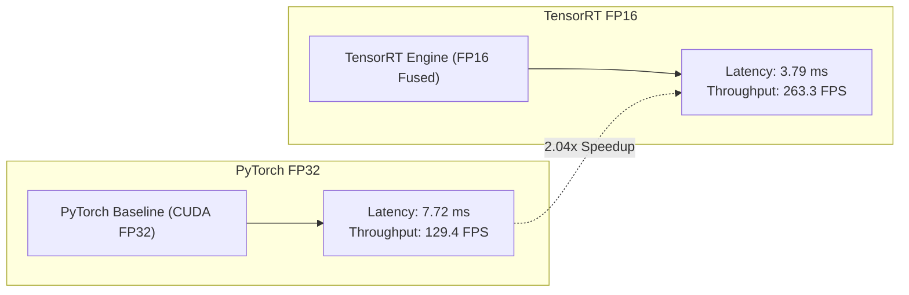

# GPU & TensorRT Acceleration Benchmark

## 1. Overview & Setup

To evaluate the acceleration ceiling of the VisionStream AI pipeline on dedicated edge/cloud GPU hardware, controlled benchmarks were executed on an NVIDIA Tesla T4 GPU in a Kaggle cloud environment:

- **GPU:** NVIDIA Tesla T4 (16 GB GDDR6, Turing Architecture, Tensor Cores)
- **Host Environment:** Linux, CUDA 12.2, TensorRT 10.x, PyTorch 2.x
- **Input Data:** In-memory preloaded video frames (640x640 resolution)
- **Primary Model:** YOLOv8n

## 2. Benchmark Comparison

<!-- Records-per-page filter: 5, 10, 30, 50, 100, 200, 300, All -->
| Execution Backend | Precision | Mean Latency (ms) | Median Latency (ms) | Throughput (FPS) | Speedup Factor |
| :--- | :--- | :--- | :--- | :--- | :--- |
| **PyTorch (CUDA)** | FP32 | 7.71975 ms | 7.68 ms | 129.43 FPS | 1.00x (Baseline) |
| **TensorRT Engine** | FP16 | **3.79172 ms** | **3.76 ms** | **263.27 FPS** | **2.04x** |

## 3. Important Engineering Notes & Caveats

1. **In-Memory vs End-to-End Streaming:**  
   These metrics represent isolated in-memory model forward passes. They do **not** reflect live RTSP streaming throughput, which involves video packet ingestion, H.264 decoding, memory copies, and tracking overhead.
2. **Hardware Specificity:**  
   The `.engine` artifact produced by TensorRT is compiled specifically for the NVIDIA Turing microarchitecture (SM 7.5). It is non-transferable to other GPU architectures or CPU targets.
