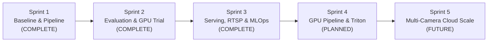

# VisionStream AI — Project Roadmap

The VisionStream AI engineering roadmap outlines past achievements and future development phases.

## Completed Milestones

- [x] **Sprint 1: Baseline Architecture**
  - Offline video processing pipeline with OpenCV and YOLOv8.
  - Initial performance benchmarking and modular code structure.
- [x] **Sprint 2: Rigorous Evaluation & GPU Acceleration**
  - Fine-tuning trial and definitive holdout validation (240 images, 972 persons).
  - Controlled Kaggle NVIDIA T4 GPU & TensorRT FP16 benchmark (2.04x speedup, 263 FPS).
- [x] **Sprint 3: Production Serving, Streaming & Optimization**
  - FastAPI model-serving gateway with Prometheus metrics and structured logging.
  - End-to-end containerized RTSP streaming (MediaMTX + GStreamer + ByteTrack).
  - ONNX Runtime CPU optimization and multi-threading benchmark.
  - Triton architecture assessment.

## Future Milestones

- [ ] **Sprint 4: GPU Streaming & Dedicated Triton Deployment**
  - Deploy NVIDIA DeepStream or TensorRT backend on dedicated NVIDIA GPU hardware.
  - Achieve true 30+ FPS real-time processing on 1080p video streams.
  - Formal KServe v2 binary tensor protocol implementation.
- [ ] **Sprint 5: Enterprise Multi-Camera Orchestration**
  - Distributed Kafka / Redpanda message brokering for track events.
  - Kubernetes / Helm deployment manifests with HPA (Horizontal Pod Autoscaling).
