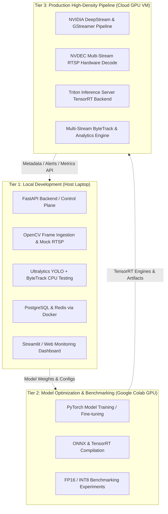

# SPRINT 00 — ENVIRONMENT & HARDWARE ASSESSMENT REPORT
**Project:** VisionStream AI  
**Assessment Date:** 2026-11-05  
**Development Machine:** LAPTOP-62621JIA  
**Operating System:** Microsoft Windows 11 Home Single Language (Build 10.0.26300, 64-bit)  
**Report Location:** `C:\my-app\visionstream-ai\reports\SPRINT-00-ENVIRONMENT-ASSESSMENT.md`

---

## 1. Executive Summary

A comprehensive, non-intrusive technical assessment was performed on the host machine `LAPTOP-62621JIA` to evaluate environment readiness for **VisionStream AI** (Real-Time Multi-Stream Computer Vision & GPU Inference Platform).

### Key Findings:
- **Compute Architecture:** The host runs an **AMD Ryzen 7 6800U** (8 cores, 16 threads) with integrated **AMD Radeon 680M Graphics** and ~16 GB RAM.
- **NVIDIA GPU Absence:** There is **no NVIDIA GPU**, no NVIDIA display driver, and no local CUDA compute capability present on this machine.
- **Local Feasibility:** The machine is well-equipped for CPU-based prototyping: Python 3.13.5, PyTorch 2.6.0 (CPU mode), Ultralytics (YOLO), OpenCV 4.12.0, Git 2.48.1, Docker CLI/Compose, and FFmpeg are present and operational. PostgreSQL client drivers (`psycopg2-binary`) and local database orchestration can run locally via Docker.
- **Cloud/Colab Requirements:** High-throughput GPU inference pipelines, TensorRT acceleration, INT8/FP16 quantization benchmarking, multi-stream NVDEC/DeepStream/GStreamer hardware decoding, and Triton Inference Server with GPU backends require remote NVIDIA GPU infrastructure (Google Colab GPU for experimentation and an NVIDIA Cloud GPU VM for end-to-end multi-stream deployment).

---

## 2. Hardware Inventory

| Component | Specification / Detected Value | Status / Notes |
| :--- | :--- | :--- |
| **Hostname** | `LAPTOP-62621JIA` | Verified |
| **CPU Model** | AMD Ryzen 7 6800U with Radeon Graphics | 8 Cores, 16 Logical Processors |
| **CPU Architecture** | x86_64 (AMD64 Family 25 Model 68 Stepping 1) | Zen 3+ microarchitecture |
| **Installed RAM** | 16.0 GB (~15,983,524 KB visible) | ~3.9 GB free at inspection |
| **GPU 0 (Active)** | AMD Radeon(TM) Graphics (Device ID: `0x1681`) | Driver: `31.0.12046.22002`, 512 MB dedicated VRAM + shared system memory |
| **NVIDIA GPU** | **None** | No NVIDIA hardware adapter detected |
| **Virtualization** | `VirtualizationFirmwareEnabled: True` | AMD-V enabled in UEFI firmware |
| **Hypervisor** | Present (Hyper-V / Virtual Machine Platform active) | Windows Hypervisor active for WSL2 / Docker |

---

## 3. Software Inventory

| Software / Tool | Detected Version | Availability | Notes |
| :--- | :--- | :--- | :--- |
| **Operating System** | Windows 11 Home Single Language (10.0.26300) | Available | 64-bit OS |
| **Python** | Python 3.13.5 | Available | System PATH |
| **Git** | 2.48.1.windows.1 | Available | System PATH |
| **Docker CLI** | Docker version 29.8.1 (build 4a63305) | Available | CLI available (`AppData\Local\Programs\DockerDesktop\resources\bin\docker.exe`) |
| **Docker Compose** | Docker Compose version v5.5.1 | Available | Docker Compose plugin operational |
| **Docker Desktop Engine** | Stopped / On-demand | Available (Stopped) | Backend service present; daemon starts with Docker Desktop |
| **WSL2** | Version 2 (`docker-desktop` distro installed) | Available | No general Linux distro (e.g. Ubuntu) currently registered in WSL |
| **Ubuntu / Linux Distro** | None installed | **Missing** | Only `docker-desktop` WSL instance registered |
| **FFmpeg** | Build 2025-07-12-git-35a6de137a | Available | Gyan.dev essentials build with H.264, x265, AMF, DXVA2, D3D11VA |
| **OpenCV** | OpenCV 4.12.0 | Available | Python module `cv2` installed |
| **PyTorch** | PyTorch 2.6.0+cu124 (`cuda.is_available(): False`) | Available (CPU fallback) | CUDA wheel installed but falls back to CPU due to AMD GPU |
| **Ultralytics (YOLO)** | 8.3.167 | Available | Python package installed |
| **ByteTrack Support** | Via `ultralytics` tracker / `lap` | Available | Built-in tracking engine in Ultralytics |
| **PostgreSQL Driver** | `psycopg2-binary` 2.9.11, `SQLAlchemy` 2.0.43 | Available | Python database drivers installed |
| **NVIDIA Container Toolkit** | Not Installed | **Missing** | Not applicable locally (requires NVIDIA GPU & Linux/WSL2) |

---

## 4. NVIDIA GPU Readiness

- **Physical GPU:** Negative. Only AMD integrated graphics (RDNA 2 / Radeon 680M) is present.
- **NVIDIA Drivers:** None installed (`nvidia-smi` not found).
- **CUDA Toolkit:** Local CUDA execution (`nvcc`, CUDA kernels) is not supported on host hardware.
- **PyTorch CUDA Status:** `torch.cuda.is_available()` returns `False`.
- **Conclusion:** All native NVIDIA CUDA, TensorRT, NVDEC, DeepStream, and NVIDIA Triton features cannot run locally on physical hardware.

---

## 5. Local Development Feasibility

The local development environment is suitable for application development, control plane logic, and CPU-based verification:

| Capability | Local Readiness | Implementation Strategy |
| :--- | :--- | :--- |
| **Python & PyTorch Development** | **Ready** | Functional on Python 3.13.5 with CPU execution. Fast iteration for pipeline logic. |
| **YOLO Inference** | **Ready (CPU)** | Runs directly using `ultralytics` on CPU (YOLOv8n / YOLO11n recommended for fast local testing). |
| **OpenCV Video Processing** | **Ready** | Fully functional with OpenCV 4.12.0 and FFmpeg for reading, writing, and transforming video streams. |
| **ByteTrack Tracking** | **Ready** | Supported locally via Ultralytics native tracker (`tracker="bytetrack.yaml"`). |
| **PostgreSQL Database** | **Ready** | Can run locally inside a Docker container (`postgres:16-alpine`) with SQLAlchemy/psycopg2. |
| **Docker-Based Development** | **Ready** | Docker CLI and Compose are ready. Docker Desktop can be launched when running containerized services. |
| **FastAPI / REST / WebSocket API** | **Ready** | FastAPI 0.119.0 and Uvicorn 0.38.0 are already installed and ready for streaming and ingestion APIs. |

---

## 6. Google Colab Feasibility

Google Colab provides free and low-cost hosted NVIDIA GPUs (T4, L4, or A100 instances depending on tier).

| Task / Workload | Colab Feasibility | Notes |
| :--- | :--- | :--- |
| **CUDA Verification & Profiling** | **Excellent** | Instant access to CUDA runtime and PyTorch GPU acceleration. |
| **Model Export & Optimization** | **Excellent** | Export PyTorch YOLO models to ONNX and evaluate baseline FP16 latency. |
| **TensorRT Conversion (T4/L4)** | **Good** | Generate TensorRT engine plans (`.engine`) matching Colab GPU architectures. |
| **Batch Inference Benchmarking** | **Excellent** | Compare CPU vs GPU inference times across various batch sizes and image resolutions. |
| **Limitation: Persistent RTSP** | **Poor / Unsuitable** | Colab is ephemeral and behind NAT; unsuitable for persistent multi-camera RTSP ingestion or long-running stream services. |

---

## 7. NVIDIA Cloud GPU Requirements

For production-grade real-time multi-stream computer vision, dedicated cloud GPU instances (e.g., RunPod, Lambda Labs, AWS G4dn/G5, or GCP G2/A2) are required for the following components:

1. **Hardware-Accelerated Decoding (NVDEC):** Decoding multiple high-bitrate RTSP 1080p/4K streams concurrently without saturating the host CPU.
2. **NVIDIA DeepStream SDK:** Native pipeline integration with GStreamer, `nvv4l2decoder`, `nvstreammux`, and `nvinfer` for zero-copy memory pipelines (NVMM).
3. **TensorRT Engine Execution:** Compiling precision-tuned FP16 and INT8 calibrated execution graphs optimized for specific streaming throughput targets.
4. **Triton Inference Server:** Multi-model dynamic batching, concurrent model execution, and gRPC streaming endpoints.
5. **High-Density Multi-Stream RTSP Processing:** Orchestrating 4 to 16+ simultaneous RTSP streams with low-latency ByteTrack re-identification.

---

## 8. Recommended Technology Architecture

A tiered hybrid architecture is recommended:

---

## 9. Identified Risks

1. **No Local NVIDIA GPU:** Developers cannot run or debug TensorRT engines, DeepStream plugins, or CUDA kernels on the physical laptop. All hardware-specific acceleration code must be developed using abstract interfaces or tested remotely.
2. **Python 3.13 Ecosystem Compatibility:** Python 3.13 is very recent. While Ultralytics, PyTorch 2.6, and OpenCV are present, some specialized computer vision C-extensions may lack prebuilt Windows wheels. A project-specific virtual environment (`venv`) will isolate dependencies.
3. **WSL2 Ubuntu Absence:** WSL2 is active, but only `docker-desktop` is installed. If local Linux testing or native Linux builds are needed, an Ubuntu WSL2 distribution should be installed in a future sprint.
4. **Colab Networking Constraints:** Multi-stream RTSP cannot be directly streamed into standard Colab instances without tunnels (e.g. ngrok or Cloudflare tunnels).

---

## 10. Recommendations for Sprint 1

1. **Local Project Structure & Environment Setup:**
   - Establish the project repository layout in `C:\my-app\visionstream-ai`.
   - Create a dedicated Python virtual environment (`.venv`) to standardize dependencies and isolate from global packages.
2. **Abstract Device Interface (Hardware Agnostic Pipeline):**
   - Design inference abstractions (`DeviceManager`) supporting `cpu`, `cuda`, and future `tensorrt` backends seamlessly.
   - Implement local mock video streaming and RTSP simulation using OpenCV and local video files.
3. **Containerized Database Setup:**
   - Create a `docker-compose.yml` for PostgreSQL and Redis to support local metadata logging and tracking event persistence.
4. **Proceed to Sprint 1 Decision:**
   - **Recommendation:** **PROCEED TO SPRINT 1.** The local environment has all foundational components (Python, PyTorch CPU, OpenCV, FFmpeg, Docker, Git) necessary to construct the application architecture, data ingestion, tracker logic, API services, and test harness without upfront GPU expenses.
