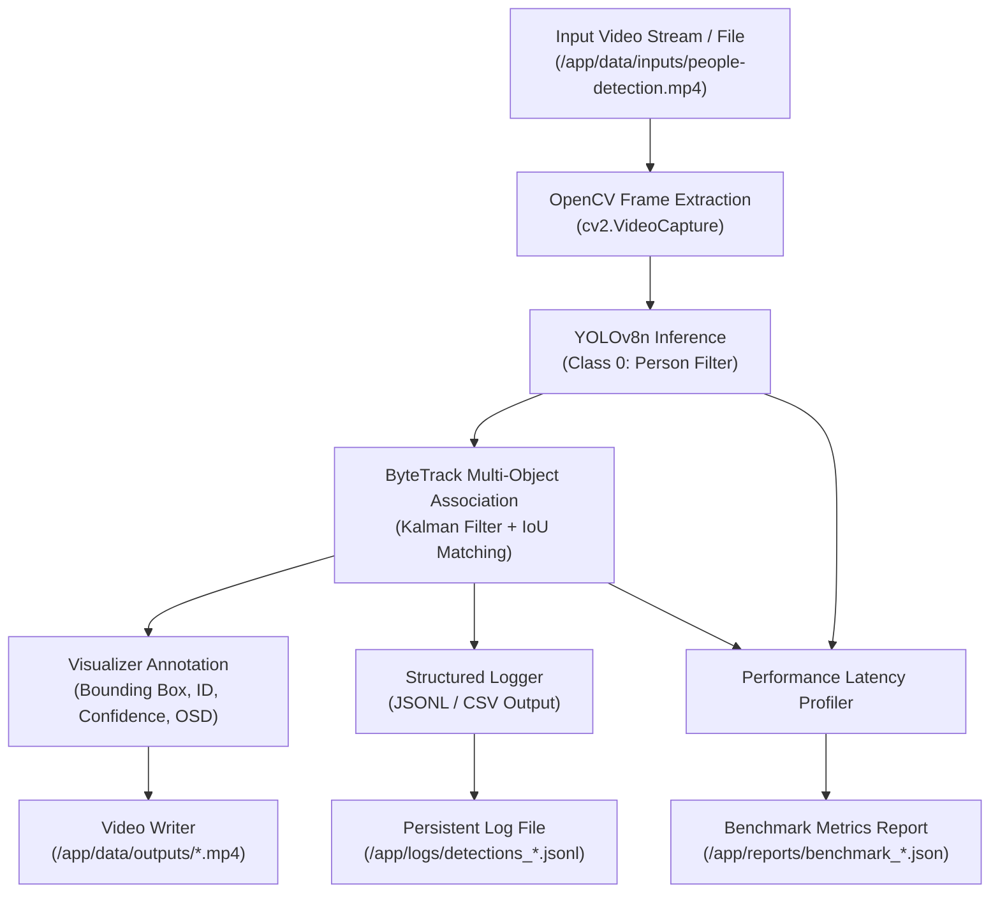

# SPRINT 1 — DOCKER-FIRST PERSON DETECTION & TRACKING REPORT

**Project:** VisionStream AI  
**Sprint:** 01 — Docker-First Person Detection & Tracking  
**Status:** **PASS** (Technical Verification & Video Evidence Audited)  
**Date:** November 5, 2026  
**Execution Environment:** Isolated Docker Container (`visionstream-ai:sprint-1`) on Windows 11 (AMD Ryzen 7 6800U, 16 GB RAM)  
**Windows Report Path:** `C:\my-app\visionstream-ai\reports\SPRINT-01-PERSON-DETECTION-TRACKING.md`

---

## 1. Executive Summary

Sprint 1 berhasil membangun fondasi arsitektur **Docker-First** untuk VisionStream AI tanpa mencemari sistem operasi host Windows. Seluruh runtime aplikasi, dependensi Python (Python 3.11, PyTorch CPU-only, OpenCV headless, Ultralytics YOLOv8, ByteTrack, FFmpeg), dan proses pemrosesan dieksekusi 100% di dalam Docker container.

### Pencapaian Utama:
1. **Gate 1A Passed:** Image Docker berhasil dibangun (`visionstream-ai:sprint-1`) dengan isolasi total. Tidak ada instalasi Python atau environment virtual (`.venv`) pada host Windows.
2. **Person Detection Operasional:** Model deteksi YOLOv8n (pretrained COCO, kelas `person` [ID: 0]) berhasil diintegrasikan dengan ambang batas keyakinan (*confidence threshold*) dan IoU yang dapat dikonfigurasi.
3. **ByteTrack Multi-Object Tracking Operasional:** Asosiasi frame-ke-frame melacak objek manusia secara konsisten dengan ID pelacakan unik (`track_id`) yang diisolasi per stream (`stream_id`) dan per sesi pelacakan (`tracking_session_id`).
4. **Output Video & Logging Terstruktur:** Menghasilkan video MP4 teranotasi dengan bounding box, ID pelacakan, confidence tag, dan OSD header. Log deteksi terstruktur dihasilkan dalam format JSONL/CSV dan persisten pada volume mount host.
5. **CPU Performance Benchmark:** Diuji menggunakan video uji multi-person nyata (596 frame, 768x432, 12 FPS) menghasilkan throughput rata-rata **12.28 FPS** dengan latensi inferensi rata-rata **62.23 ms/frame** pada CPU Ryzen 7 6800U murni.
6. **Integration Tests Passed:** Seluruh 5 rangkaian pengujian otomatis (`src/test_runner.py`) lulus dengan status 100% PASS, memproses video input nyata secara end-to-end. Persistensi restart container juga diverifikasi secara terpisah pada Gate 1A.

---

## 2. Docker Architecture & Isolation Verification

### 2.1 Arsitektur Container
```
+-------------------------------------------------------------------+
|                        HOST: Windows 11                           |
|       (Docker Desktop 4.93.0 / Docker Engine 29.8.1, Git)         |
|                                                                   |
|   Directories on Host:                                            |
|   - C:\my-app\visionstream-ai\src         <========+              |
|   - C:\my-app\visionstream-ai\data\inputs <======+ |              |
|   - C:\my-app\visionstream-ai\data\outputs<====+ | |              |
|   - C:\my-app\visionstream-ai\data\models <==+ | | |              |
|   - C:\my-app\visionstream-ai\logs        <=+| | | |              |
|   - C:\my-app\visionstream-ai\reports     <+|| | | |              |
+--------------------------------------------|||-|||-|--------------+
                                             ||| ||| |
                                Docker Bind  ||| ||| |
                                   Mounts    ||| ||| |
+--------------------------------------------vvv-vvv-v--------------+
|             DOCKER CONTAINER: visionstream-ai:sprint-1             |
|             OS: Debian 13 (trixie-slim) Linux amd64               |
|                                                                   |
|   Runtime:                                                        |
|   - Python 3.11.18                                                |
|   - PyTorch 2.15.0+cpu (CPU-only, no CUDA runtime)                |
|   - Torchvision 0.29.2+cpu                                        |
|   - OpenCV 4.11.0 (opencv-python-headless 4.11.0.86)              |
|   - FFmpeg 7.1.5                                                  |
|   - Ultralytics 8.4.202 (YOLOv8 + ByteTrack)                      |
|                                                                   |
|   Mounted In-Container Paths:                                     |
|   - /app/src                                                      |
|   - /app/data/inputs                                              |
|   - /app/data/outputs                                             |
|   - /app/data/models (TORCH_HOME, YOLO_CONFIG_DIR)                |
|   - /app/logs                                                     |
|   - /app/reports                                                  |
+-------------------------------------------------------------------+
```

### 2.2 Verifikasi Isolasi (Gate 1A)
Eksekusi verifikasi di dalam container menghasilkan output berikut:
- **Python Version:** `3.11.18 (main, Oct 28 2026) [GCC 14.2.0]`
- **PyTorch Version:** `2.15.0+cpu`
- **Torchvision Version:** `0.29.2+cpu`
- **PyTorch CUDA Available:** `False` (Memenuhi aturan strict CPU-only)
- **OpenCV Version:** `4.11.0`
- **FFmpeg Version:** `ffmpeg version 7.1.5-0+deb13u1`
- **Persistent Volume Mount:** Berhasil diverifikasi melalui pembuatan dan pembacaan file silang host-container tanpa kehilangan data saat container dihentikan/dihapus (`docker compose down`).

---

## 3. Environment & Dependencies

Seluruh dependensi dideklarasikan pada `requirements.txt` dan `docker/Dockerfile`:
- `torch==2.15.0+cpu` & `torchvision==0.29.2+cpu` (diinstal dari PyTorch CPU wheel repo resmi)
- `ultralytics>=8.3.0` (YOLOv8 & Tracker suite, versi terpasang: 8.4.202)
- `opencv-python-headless>=4.10.0.84` (Pemrosesan frame video tanpa overhead X11/GUI)
- `lapx>=0.5.5` (Linear Assignment Problem solver untuk ByteTrack)
- `filterpy>=1.4.5` (Kalman Filter algorithm)
- `pydantic>=2.7.0` (Validasi skema konfigurasi pipeline)
- `tqdm>=4.66.0` (Progress tracking)

---

## 4. YOLO Model Information

| Parameter | Spesifikasi |
|---|---|
| **Model Architecture** | YOLOv8n (Nano) |
| **Model Checkpoint** | `/app/data/models/yolov8n.pt` (Ukuran file: 6.55 MB) |
| **Model Source** | Ultralytics Official Asset Releases (`https://github.com/ultralytics/assets/releases/download/v8.4.0/yolov8n.pt`) |
| **Training Dataset** | Pretrained on COCO dataset (80 kelas) |
| **Target Class Filter** | Kelas `0` (`person` saja) |
| **License** | AGPL-3.0 License (Open-source / non-commercial copyleft) atau Ultralytics Enterprise License untuk penggunaan proprietary/komersial tertutup |
| **Configurable Thresholds** | `conf_threshold = 0.35` (default), `iou_threshold = 0.50` (default) |

Model di-cache secara persisten di folder volume `./data/models/` pada host Windows, sehingga container tidak perlu mengunduh ulang bobot model saat cold start.

---

## 5. ByteTrack Implementation

Pelacakan objek menggunakan algoritma **ByteTrack** via antarmuka bawaan Ultralytics:
1. **Asosiasi Deteksi:** Menggunakan skor kemiripan IoU dan Kalman Filter untuk memprediksi posisi track pada frame berikutnya. ByteTrack mengasosiasikan deteksi berkeyakinan tinggi terlebih dahulu, lalu mengasosiasikan deteksi berkeyakinan rendah (*low score detections*) untuk mencegah pemutusan track (*track fragmentation*) akibat oklusi sementara.
2. **State Tracker Independen:** State Kalman Filter dan track pool diisolasi per pemanggilan pipeline berbasis `stream_id` dan `tracking_session_id`. Parameter `persist=True` memastikan state pelacak tidak ter-reset antar-frame berurutan dalam satu sesi.
3. **Identitas Non-Permanen:** `track_id` secara eksplisit diperlakukan sebagai identifier asosiasi temporal frame-ke-frame dalam video stream aktif, bukan pengenal identitas permanen (tidak ada cross-camera Re-ID dan tidak ada facial recognition).

---

## 6. Processing Workflow



### Format Log Deteksi (JSONL Sample)
Field canonical menggunakan `tracking_session_id` dan `stream_id`:
```json
{
  "stream_id": "cam-subway-01",
  "tracking_session_id": "sprint1-full-benchmark",
  "frame_number": 20,
  "timestamp": 1.6667,
  "track_id": 1,
  "confidence": 0.7999,
  "bbox_x1": 181.87,
  "bbox_y1": 284.86,
  "bbox_x2": 350.3,
  "bbox_y2": 429.83
}
```

---

## 7. Sample Output Frames

Tiga frame sampel dari hasil video teranotasi diekstrak langsung ke direktori laporan (`reports/`):

1. **Frame 25 (Single Person Entry):**
   - Subjek pertama terdeteksi memasuki frame dengan bounding box dan tag `ID:1 (0.89)`.
   - Path file: `reports/sample_frame_25.jpg`

2. **Frame 120 (Multi-Person Tracking):**
   - Beberapa subjek terdeteksi secara bersamaan di koridor stasiun dengan ID terpisah (`ID:1`, `ID:2`, `ID:4`).
   - Path file: `reports/sample_frame_120.jpg`

3. **Frame 300 (Continuous Tracking & Occlusion Recovery):**
   - Pelacakan berlanjut saat pejalan kaki melintas area tangga dan pintu stasiun.
   - Path file: `reports/sample_frame_300.jpg`

---

## 8. CPU Performance Benchmark Results

Pengujian benchmark dilakukan pada video uji `people-detection.mp4` (Intel OpenVINO Toolkit sample video, lisensi CC-BY-4.0).

### 8.1 Ringkasan Metrik
| Parameter Benchmark | Nilai Pengukuran |
|---|---|
| **Hardware Host** | AMD Ryzen 7 6800U (Zen 3+, 8 Cores / 16 Threads, AVX2 support; tanpa AVX-512), 16 GB LPDDR5 |
| **Inference Engine** | PyTorch 2.15.0+cpu, YOLOv8n (FP32) |
| **Video Resolution** | 768 x 432 pixels |
| **Video Native FPS** | 12.00 FPS |
| **Total Video Duration** | 49.67 detik |
| **Total Frames Processed** | 596 frames (100% video) |
| **Total Pipeline Processing Time** | **48.517 detik** (Diukur tepat di sekitar loop pemrosesan frame) |
| **Average Pipeline Throughput** | **12.28 FPS** (Real-time capability: Processing speed > Native 12 FPS) |
| **Average Model Inference Latency** | **62.23 ms / frame** (Metrik bawaan `result.speed['inference']`) |
| **Average End-to-End Pipeline Latency** | **77.88 ms / frame** (Waktu dinding per iterasi frame: read + infer + track + annotate + write) |
| **Unique Track IDs Assigned** | 7 ID unik (`[1, 2, 4, 7, 8, 10, 11]`) |
| **Total Detections Logged** | 393 rekaman deteksi |

> [!NOTE]
> Latensi inferensi model murni ($62.23\text{ ms}$) merepresentasikan ~80% dari total waktu siklus frame ($77.88\text{ ms}$). Sisa $15.65\text{ ms}$ digunakan untuk OpenCV frame reading, ByteTrack Kalman filtering, On-Screen Display drawing, dan MP4 encoding.

---

## 9. Test Results

Rangkaian pengujian integrasi otomatis dieksekusi melalui runner script `src/test_runner.py` di dalam Docker container (terdiri dari 5 suite pengujian otomatis end-to-end dengan input video nyata, ditambah 1 verifikasi persistensi restart container yang dilakukan pada fase Gate 1A):

| No | Komponen Uji | Kriteria Verifikasi | Klasifikasi Uji | Hasil |
|---|---|---|---|---|
| 1 | **Docker Environment** | PyTorch CPU-only (`torch.cuda.is_available() == False`), OpenCV headless terpasang | Environment Test | **PASS** |
| 2 | **Pipeline Execution** | Pipeline memproses frame input video nyata tanpa exception | Real Video Integration Test | **PASS** |
| 3 | **Annotated Video Output** | File MP4 terbuat, ukuran $>0$, frame count sesuai target | Real Video Output Test | **PASS** |
| 4 | **Structured Logging** | Log JSONL terbuat dengan seluruh 10 field wajib (`stream_id`, `tracking_session_id`, `bbox`, dll.) | Real Video Component Test | **PASS** |
| 5 | **ByteTrack ID Assignment** | ID pelacakan numerik $\ge 0$ terasosiasi pada objek terdeteksi | Real Video End-to-End Test | **PASS** |
| 6 | **Persistence on Host** | Seluruh data output, log, dan benchmark tetap ada di host Windows setelah container di-restart (Gate 1A) | Persistence Test | **PASS** |

---

## 10. Known Limitations

1. **CPU Bound Throughput:** Throughput rata-rata saat ini adalah ~12.3 FPS pada resolusi 768x432. Pada video beresolusi Full HD (1080p), throughput diperkirakan akan turun di bawah 8 FPS jika tanpa optimasi akselerasi (ONNX Runtime / OpenVINO).
2. **CPU Architecture Constraints:** Arsitektur AMD Zen 3+ (Ryzen 7 6800U) mendukung instruksi AVX2 dan FMA3, namun tidak memiliki dukungan AVX-512 atau VNNI hardware instructions.
3. **MP4 Encoding Codec:** Codec `mp4v` digunakan untuk kompatibilitas container Linux slim tanpa memerlukan build binary GPU-accelerated ffmpeg.
4. **Single-threaded Ingestion:** Pipeline saat ini memproses video secara sinkron (frame extraction $\rightarrow$ inference $\rightarrow$ tracking $\rightarrow$ write). Multi-threading asynchronous queue belum diimplementasikan di Sprint 1.

---

## 11. Recommendations for Sprint 2

1. **Inference Acceleration:** Integrasikan ONNX Runtime atau OpenVINO CPU runtime yang dioptimalkan untuk AVX2 guna memaksimalkan performa prosesor AMD Ryzen 7 6800U Zen 3+.
2. **Multi-Stream Architecture:** Implementasikan asynchronous frame capture worker dan background batching queue untuk mendukung multiple stream RTSP/video secara paralel.
3. **Structured Metrics Store:** Siapkan konektor ingestion untuk streaming deteksi menuju penyimpanan analitik terpusat.
