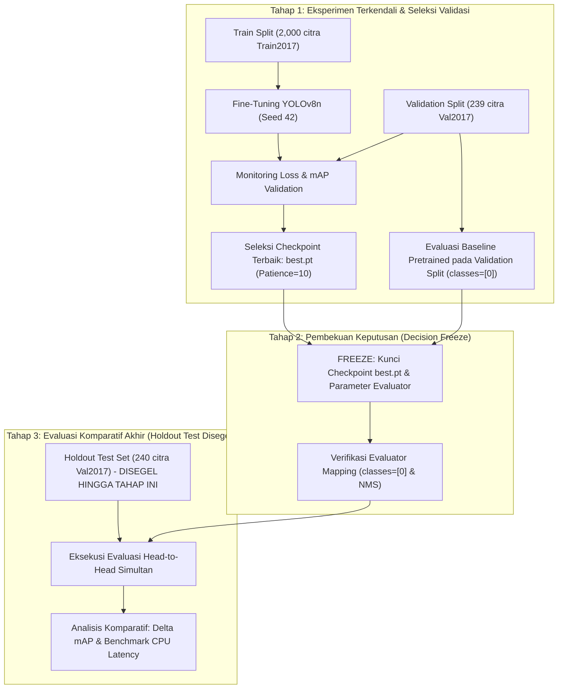

# SPRINT 2 — TASK S2.3
## TRAINING EXPERIMENT SETUP & FINE-TUNING EXECUTION PLAN (REVISED v1.2.0)

**Project:** VisionStream AI  
**Task Identifier:** `S2.3 — Training Experiment Setup & Fine-Tuning Execution Plan`  
**Governing Phase:** Phase 3 (Operational Sprint 2 — Model Training & Evaluation)  
**Execution Environment:** Isolated Docker-first Development Machine `LAPTOP-62621JIA`  
**Host Architecture:** Windows 11, AMD Ryzen 7 6800U, AMD Radeon 680M (Integrated GPU, discrete NVIDIA GPU NOT AVAILABLE)  
**Document Date:** November 5, 2026 (Revised v1.2.0: November 5, 2026)  
**Canonical File Location:** `C:\my-app\visionstream-ai\reports\SPRINT-02-S2.3-TRAINING-EXPERIMENT-PLAN.md`  
**Task Status:** **PASS** (Technical Planning & Final Documentation Revision Complete — Zero Training / Inference Executed)

---

## Revision History

| Version | Date | Author / Agent | Changes Summary |
|---|---|---|---|
| 1.0.0 | 2026-11-05 | Antigravity Engine | Draf awal rencana eksperimen pelatihan dan perbandingan model Sprint 2. |
| 1.1.0 | 2026-11-05 | Antigravity Engine | Revisi Architecture Review: (A) Proteksi ketat Holdout Test; (B) Protokol perbandingan baseline adil (`classes=[0]`); (C) Detail transfer learning & re-inisialisasi head; (D) Pemisahan 3 domain metrik; (E) Penguatan metadata reprodusibilitas; (F) Konsistensi konfigurasi; (G) Klasifikasi estimasi komputasi & transfer data Colab; (H) Pemisahan hukum lisensi software vs bobot model; (I) Reklasifikasi kriteria penerimaan objektif. |
| 1.2.0 | 2026-11-05 | Antigravity Engine | Final Documentation Corrections: (1) Membedakan lisensi software Ultralytics dari ketentuan distribusi checkpoint tanpa klaim hukum kategoris sepihak tentang bobot turunan, public GitHub, atau SaaS tertutup; menegaskan perlunya verifikasi otoritatif dan tinjauan hukum resmi ($0 lisensi dibeli); (2) Koreksi terminologi optimizer AdamW menjadi `weight_decay=0.0005` (menghapus label `decay=0.0005`); (3) Pendefinisian eksplisit titik operasional: confidence threshold 0.35, ground-truth matching IoU 0.50, dan NMS IoU 0.65 serta formulasi formal TP, FP, FN; (4) Penguatan protokol integritas dataset Colab via Google Drive (verifikasi SHA-256 arsip sebelum upload, pasca-transfer, dan integritas hash citra pasca-ekstraksi dengan aturan abort jika mismatch); (5) Pengoreksian klaim real-time CPU YOLOv8n sebagai target proyek (bukan jaminan established). |

---

## 1. Executive Summary

Task S2.3 menetapkan rencana eksekusi teknis yang terperinci, terkontrol secara metodologis, dan dapat direproduksi (*reproducible*) untuk eksperimen pelatihan dan perbandingan model pada Sprint 2. Perencanaan ini dibangun di atas baseline dataset yang telah diakuisisi dan divalidasi pada Task S2.2 (`coco-person`: 2,479 citra berlisensi murni CC BY 2.0).

Tujuan inti dari eksperimen ini adalah membandingkan secara empiris model dasar (*pretrained baseline*) `yolov8n.pt` dengan model hasil pelatihan lanjutan (*continued fine-tuned model*) khusus kelas `person`. Perbandingan dilakukan melalui metodologi pengujian terkontrol (*controlled experiment*) di mana **Holdout Test Split (240 citra)** disegel (*strictly sealed*) dan hanya dievaluasi satu kali setelah seluruh keputusan hyperparameter dan checkpoint selection dibekukan.

Dokumen revisi versi 1.2.0 ini menyempurnakan aspek metodologis dan kepatuhan:
1. **Holdout Test Protection:** Evaluasi persiapan dan seleksi checkpoint dialokasikan murni pada Validation Split (239 citra). Holdout test tidak pernah disentuh sebelum evaluasi head-to-head akhir.
2. **Fair Baseline Comparison:** Menyaring prediksi model baseline 80-kelas khusus untuk kelas `person` (Class ID 0) menggunakan mekanisme resmi Ultralytics (`classes=[0]`), memastikan tidak ada kontaminasi deteksi non-person.
3. **Mekanisme Transfer Learning:** Mendokumentasikan transfer bobot backbone/neck dan re-inisialisasi layer klasifikasi head dari $80 \to 1$ kelas, serta prosedur audit missing/incompatible weights via log PyTorch.
4. **Pemisahan Domain Metrik:** Memisahkan secara tegas metrik akurasi bebas ambang batas (mAP@50, mAP@50-95), metrik titik operasional (Precision/Recall pada `conf=0.35`, matching `IoU=0.50`, dan `NMS IoU=0.65`), serta performa komputasi target latensi CPU (ms) & FPS.
5. **Integritas Transfer Dataset Colab:** Memperkuat protokol integritas transfer data via Google Drive privat dengan verifikasi ganda SHA-256 (sebelum upload, pasca-transfer, dan pasca-ekstraksi) serta kebijakan pembatalan eksperimen (*abort*) jika terdeteksi inkonsistensi hash.
6. **Kepatuhan Hukum & Objektivitas Lisensi:** Menghindari kesimpulan hukum kategoris sepihak tentang status bobot model turunan atau jaminan kepatuhan GitHub, menetapkan perlunya tinjauan hukum resmi untuk penggunaan komersial, dan menegaskan tidak ada pembelian lisensi komersial yang diotorisasi.

Sesuai otorisasi S2.3, **tidak ada proses pelatihan model, inferensi, alokasi komputasi cloud, atau pengeluaran finansial yang dijalankan**.

---

## 2. Authoritative Baseline & Inherited Constraints

### 2.1 Dataset Baseline (S2.2 Closed — PASS WITH LIMITATIONS)
Dataset yang digunakan disimpan di direktori `data/datasets/coco-person/` dengan spesifikasi yang telah diaudit:
- **Train Set:** 2,000 citra (`images/train/`) $\leftrightarrow$ 2,000 file label (`labels/train/`), bersumber dari COCO Train2017.
- **Validation Set:** 239 citra (`images/val/`) $\leftrightarrow$ 239 file label (`labels/val/`), bersumber dari COCO Val2017.
- **Holdout Test Set:** 240 citra (`images/test/`) $\leftrightarrow$ 240 file label (`labels/test/`), bersumber dari COCO Val2017.
- **Total Citra & Bounding Box:** 2,479 citra, 9,969 person bounding boxes (format YOLO TXT `0 xc yc w h`).
- **Integritas Split:** Terbukti 100% saling lepas (*strictly disjoint* tanpa tumpang tindih ID citra maupun hash SHA-256).
- **Lisensi:** Seluruh 2,479 citra memiliki **License ID 4 (CC BY 2.0)** berdasarkan metadata resmi COCO Consortium.

### 2.2 Keterbatasan Metodologis Inheren
1. **Verifikasi Lisensi:** Status lisensi CC BY 2.0 berasal dari metadata anotasi resmi konsorsium COCO, bukan hasil audit real-time independen ke API server Flickr.
2. **Pemaparan Domain Pretrained:** Checkpoint dasar `yolov8n.pt` dilatih oleh Ultralytics pada 118,287 citra COCO Train2017. Dengan demikian, subset 2,000 citra pelatihan pada pilot ini berada di dalam domain distribusi data asli model tersebut.
3. **Pemaparan Validasi COCO:** Kumpulan data COCO Val2017 berpotensi pernah terpapar dalam seleksi arsitektur dan penentuan hyperparameter checkpoint dasar Ultralytics.
4. **Definisi Formal Eksperimen:** Eksperimen ini diklasifikasikan secara ketat sebagai:
   > **"Continued COCO-domain fine-tuning / single-class focus within the existing COCO distribution"**
   > *Dilarang mengklaim generalisasi domain independen (out-of-domain generalization) hanya berdasarkan evaluasi holdout test COCO ini.*

### 2.3 Baseline Sprint 1
Sprint 1 telah mengunci arsitektur inferensi deteksi YOLOv8n dan pelacakan ByteTrack pada runtime CPU Docker lokal (`12.28 FPS` rata-rata pada video 768x432). Seluruh implementasi kode dan artefak Sprint 1 tetap dipertahankan tanpa perubahan.

---

## 3. Model Strategy & Transfer Learning Mechanics

### 3.1 Checkpoint Baseline & Provenance
- **Model Checkpoint:** `data/models/yolov8n.pt` (FP32, 6,549,796 bytes).
- **SHA-256 Checkpoint Baseline:** `f59b3d833e2ff32e194b5bb8e08d211dc7c5bdf144b90d2c8412c47ccfc83b36`.
- **Kesesuaian untuk Pilot:** YOLOv8n (3.2 juta parameter) merupakan arsitektur nano teringan dalam famili Ultralytics, memungkinkan transfer learning yang cepat serta menjadi kandidat utama untuk mencapai target throughput inferensi real-time pada CPU lokal.

### 3.2 Detail Mekanisme Transfer Learning & Transisi Detection Head
Model dasar `yolov8n.pt` dirancang untuk deteksi 80 kelas COCO. Transisi menuju dataset single-class (`person`, ID `0`) melibatkan pembedaan layer yang ditransfer dan yang di-inisialisasi ulang:

1. **Layer yang Ditransfer Penuh (*Preserved / Transferred Layers*):**
   - **Backbone (CSPDarknet):** Seluruh layer ekstraksi fitur konvolusional (Stem, C2f, SPPF) mentransfer bobot representasi visual secara utuh.
   - **Neck (PANet):** Seluruh layer integrasi fitur multi-skala (Feature Pyramid Network / Path Aggregation Network) ditransfer secara utuh.
   - **Bounding Box Regression Sub-head (`cv2`):** Layer konvolusi regresi bounding box (DFL - Distribution Focal Loss) tidak bergantung pada jumlah kelas, sehingga bobot spasialnya dapat ditransfer penuh.
2. **Layer yang Di-inisialisasi Ulang (*Reinitialized Layers*):**
   - **Class Classification Sub-head (`cv3`):** Layer konvolusi klasifikasi akhir memproyeksikan fitur menuju dimensi kelas ($N_{\text{classes}}$). Pada checkpoint awal, layer ini memiliki dimensi output 80 kanal per level piramida fitur. Saat beralih ke 1 kelas, kanal output menyusut dari $80 \to 1$. Bobot pada layer konvolusi output klasifikasi ini **tidak kompatibel secara dimensi dan wajib di-inisialisasi ulang secara acak (*reinitialized*)**.
3. **Prosedur Audit Loading Bobot (*Loading Log Verification*):**
   - Saat runtime inisialisasi model di Colab/Docker (`model = YOLO('yolov8n.pt')` lalu `model.train(data='dataset.yaml')`), pustaka Ultralytics mengekstrak `state_dict` PyTorch.
   - Sistem wajib memeriksa dan mencatat log konsol model loading:
     ```text
     Transferred X/Y items from pretrained weights
     ```
   - Skrip audit pra-pelatihan wajib membandingkan kunci bobot model awal vs model target dan mendokumentasikan secara eksplisit daftar layer yang cocok (*matched keys*) serta layer yang diinisialisasi ulang (*missing / size mismatch keys*).

### 3.3 Protokol Perbandingan Baseline yang Adil (*Fair Baseline Comparison*)
Untuk memastikan evaluasi komparatif antara model baseline (80 kelas) dan model fine-tuned (1 kelas) bersifat valid (*apple-to-apple*):

1. **Pemetaan Semantik Kelas:**
   - COCO person class ID: `0`.
   - Dataset pilot class ID: `0`.
2. **Penyaringan Prediksi Baseline:**
   - Model baseline `yolov8n.pt` memprediksi 80 kelas secara bersamaan. Saat dievaluasi terhadap ground truth dataset single-class, prediksi non-person (seperti mobil, tas, kursi) akan dianggap False Positive fatal jika tidak difilter.
   - **Mekanisme Evaluasi Ultralytics:** Evaluasi model baseline wajib memanfaatkan argumen parameter resmi Ultralytics:  
     `classes=[0]`  
     Argumen ini memfilter output tensor sebelum kalkulasi metrik, memastikan hanya deteksi berlabel `person` yang diikutsertakan.
3. **Persyaratan Verifikasi Teknis S2.4:**
   - Parameter `classes=[0]` dan penyelarasan evaluator antara model 80-kelas dan 1-kelas wajib diverifikasi secara empiris melalui *dry-run assertion* sebelum hasil benchmark holdout test dinyatakan sah.
   - Kedua model wajib diuji menggunakan pipeline preprocessing citra ($640 \times 640$, letterbox), confidence floor evaluasi mAP, dan NMS IoU threshold yang identik.

### 3.4 Pertimbangan Lisensi Model (Ultralytics Licensing Terms)
Pemeriksaan lisensi model memisahkan secara objektif berbagai ketentuan hukum yang berlaku:
1. **Lisensi Perangkat Lunak (Software Library):** Kerangka kerja Ultralytics didistribusikan di bawah lisensi open-source **GNU Affero General Public License v3.0 (AGPL-3.0)**, dengan opsi lisensi komersial Enterprise License untuk penggunaan proprietary.
2. **Ketentuan Distribusi Model Checkpoint:** Checkpoint resmi `yolov8n.pt` dirilis oleh Ultralytics di bawah ketentuan open-source AGPL-3.0.
3. **Status Hukum Bobot Hasil Fine-Tuning:**  
   Status hukum pasti mengenai apakah bobot neural network hasil fine-tuning secara otomatis terkualifikasi sebagai karya turunan (*derivative work*) di bawah yurisdiksi hak cipta perangkat lunak merupakan isu hukum terbuka yang belum memiliki preseden hukum seragam. Dokumen ini **tidak membuat kesimpulan hukum kategoris sepihak** mengenai status karya turunan tersebut.
4. **Kepatuhan Publikasi & Penggunaan Komersial:**  
   Meskipun mempublikasikan kode secara terbuka di GitHub dengan atribusi jelas kepada Ultralytics Ltd. merupakan praktik umum komunitas open-source, publikasi tersebut **tidak dapat secara apriori diklaim sebagai jaminan kepatuhan hukum penuh tanpa syarat**. Demikian pula, implikasi integrasi pada layanan komersial atau SaaS tertutup merupakan hal yang memerlukan verifikasi otoritatif terhadap ketentuan resmi Ultralytics dan tinjauan hukum profesional tersendiri.
5. **Batasan Otorisasi Finansial:**  
   Dalam ruang lingkup proyek portofolio VisionStream AI, **tidak ada pembelian lisensi komersial yang diotorisasi**.

---

## 4. Training Configuration Proposal

### 4.1 Parameter Pelatihan Terjustifikasi (Fine-Tuning Pilot)

> [!NOTE]
> Parameter berikut merupakan proposal teknis terjustifikasi (*Planning Proposal*) untuk tahap eksekusi mendatang. Pelatihan belum dijalankan.

| Parameter | Nilai Rekomendasi | Alternatif Masuk Akal | Justifikasi Teknis |
|:---|:---:|:---:|:---|
| **Base Weights** | `data/models/yolov8n.pt` | `yolov8s.pt` | Checkpoint nano resmi (SHA-256 diverifikasi pada Bab 3.1). |
| **Dataset Config** | `data/datasets/coco-person/dataset.yaml` | - | Mengacu ke direktori dataset terkurasi 2,479 citra CC BY 2.0. |
| **Image Size (`imgsz`)** | **640** | 512 / 640 | Resolusi native YOLOv8; mempertahankan resolusi pejalan kaki jarak jauh. |
| **Batch Size** | **16** | 8 / 32 | Optimal untuk GPU Colab T4 16GB (< 4GB VRAM usage) dan stabilitas gradien. |
| **Epochs** | **50** | 30 / 100 | Jumlah yang cukup untuk transfer learning tanpa risiko overfitting berlebih. |
| **Optimizer** | **AdamW** | SGD (`lr0=0.01`) | Adaptive learning rate dengan decoupled weight decay (`weight_decay=0.0005`) sangat ideal untuk fine-tuning. |
| **Weight Decay** | **`weight_decay=0.0005`** | 0.001 / 0.0001 | Regularisasi $L_2$ standar Ultralytics AdamW untuk mencegah bobot meledak. |
| **Initial LR (`lr0`)** | **0.001** | 0.0005 / 0.01 | Lebih rendah dari training from scratch (`0.01`) guna mencegah kerusakan bobot visual (*catastrophic forgetting*). |
| **Final LR (`lrf`)** | **0.01** | 0.1 | Cosine learning rate decay menuju minimum $10^{-5}$. |
| **Warmup Epochs** | **3.0** | 2.0 / 5.0 | Menstabilkan penyesuaian gradien pada adaptasi head deteksi 1 kelas baru. |
| **Early Stopping (`patience`)**| **10 epoch** | 15 epoch | Menghentikan pelatihan jika mAP@50-95 pada Validation Set tidak membaik selama 10 epoch berturut-turut. |
| **Random Seed** | **42** | - | Menjamin determinisme data loader dan shuffling batch. |
| **Mixed Precision (`amp`)** | **True** (FP16) | False (FP32) | Memanfaatkan Tensor Cores GPU T4 untuk akselerasi hingga $2\times$ dan efisiensi memori. |
| **Workers** | **4** | 2 / 8 | Multiprocessing DataLoader seimbang tanpa membebani I/O virtual VM. |
| **Checkpoint Policy** | `save_period=-1` (save `best.pt` & `last.pt`) | Save every 10 epochs | Menghemat ruang disk ephemeral VM; seleksi model terbaik berbasis validasi mAP@50-95. |

### 4.2 Parameter Augmentasi Data (*Data Augmentation Settings*)
- **Horizontal Flip (`fliplr`):** `0.5` (simetri postur pejalan kaki).
- **Scale:** `0.5` (variasi skala pejalan kaki dekat vs jauh).
- **Translate:** `0.1` (pergeseran koordinat objek).
- **Mosaic Augmentation:** `1.0` pada 40 epoch pertama, dinonaktifkan secara otomatis pada 10 epoch terakhir (`close_mosaic=10`) untuk memastikan konvergensi lokalisasi bounding box pada citra natural.
- **MixUp / Copy-Paste:** `0.0` (dinonaktifkan untuk menghindari artefak semantik berlebihan pada dataset skala 2,000 citra).
- **Dropout:** `dropout=0.0` (dinonaktifkan, konsisten dengan arsitektur standar YOLOv8n).

---

## 5. Experiment Design & Holdout Test Protection

### 5.1 Protokol Proteksi Holdout Test (*Strict Sealed Test Set Protocol*)
Untuk menjamin integritas saintifik dan mencegah kebocoran data (*data leakage / information snooping*):
1. **Fase Eksperimen & Seleksi Murni Validasi:** Selama tahap persiapan, eksplorasi hyperparameter, monitoring epoch loss, dan penentuan checkpoint terbaik (`best.pt`), sistem **hanya boleh membaca Validation Split (239 citra)**.
2. **Penyegelan Holdout Test:** Direktori `images/test/` dan `labels/test/` (240 citra) **disegel penuh (*sealed*)**. Hasil pengujian holdout test **dilarang diinspeksi** untuk mengubah parameter pelatihan atau memilih model.
3. **Pembekuan Keputusan (*Decision Freeze*):** Seluruh konfigurasi pelatihan, parameter NMS, dan checkpoint model hasil seleksi validasi wajib dibekukan secara tertulis sebelum pengujian holdout test dimulai.
4. **Evaluasi Akhir Satu Kali (*One-Pass Final Head-to-Head Evaluation*):** Model baseline `yolov8n.pt` dan model fine-tuned `best.pt` diuji berdampingan pada Holdout Test Set dalam satu sesi evaluasi komparatif akhir menggunakan evaluator dan kondisi yang identik.

### 5.2 Alur Kerja Eksperimen Terkendali (Controlled Workflow)


---

## 6. Evaluation Methodology & Metric Separation

Evaluasi model pada Sprint 2 dipisahkan secara tegas ke dalam tiga kategori keluaran (*three distinct evaluation outputs*):

### 6.1 Kategori A: Metrik Akurasi Deteksi Bebas Ambang Batas (*Threshold-Independent Detection Metrics*)
Dihitung pada kurva Precision-Recall (PR) komprehensif menggunakan ground-truth bounding box:
1. **mAP@50:** Mean Average Precision pada ambang batas IoU evaluasi spasial $0.50$.
2. **mAP@50-95:** Rata-rata mAP pada 10 ambang batas IoU evaluasi dari $0.50$ hingga $0.95$ dengan interval $0.05$ (metrik standar baku COCO).
3. **Precision-Recall Curve:** Kurva integral hubungan presisi dan recall melintasi seluruh spektrum confidence dari $0.0$ hingga $1.0$.
4. **Confidence Floor:** Evaluasi mAP wajib menggunakan confidence floor yang sangat rendah (`conf=0.001` standar pycocotools / Ultralytics val) agar seluruh deteksi kandidat terintegrasi ke dalam kurva PR secara matematis. Ambang batas operasional $0.35$ **dilarang digunakan** sebagai filter awal mAP.

### 6.2 Kategori B: Metrik Titik Operasional Terdefinisi (*Defined Operating-Point Metrics*)
Mengukur kinerja deteksi pada titik ambang batas operasional yang ditentukan secara ketat:

1. **Parameter Titik Operasional yang Ditetapkan:**
   - **Confidence Threshold Operasional:** Ditetapkan secara konsisten pada **`conf = 0.35`** (merujuk baseline operasional Sprint 1).
   - **Ground-Truth Matching IoU Threshold:** Ditetapkan pada **`IoU = 0.50`** (kriteria tumpang tindih spasial untuk menentukan apakah deteksi berhasil mencakup ground-truth).
   - **Postprocessing NMS IoU Threshold:** Ditetapkan pada **`IoU = 0.65`** (kriteria supresi bounding-box duplikat pada orang yang sama saat inferensi).
2. **Pembedaan Tujuan Ketiga Ambang Batas:**
   - *Confidence Threshold (0.35):* Menyaring deteksi kandidat dengan skor keyakinan rendah guna menekan false alarm di skenario streaming CCTV.
   - *Ground-Truth Matching IoU (0.50):* Standar verifikasi saintifik apakah prediksi model bersesuaian dengan kotak anotasi acuan.
   - *NMS IoU (0.65):* Algoritma non-maximum suppression untuk memastikan satu individu hanya menghasilkan satu kotak deteksi.
3. **Formulasi Perhitungan pada Titik Operasional:**
   - **True Positive ($TP_{@0.35}$):** Bounding-box prediksi kelas `person` dengan skor keyakinan $\ge 0.35$ yang memiliki $\text{IoU} \ge 0.50$ terhadap ground-truth bounding-box `person` yang belum terasosiasi.
   - **False Positive ($FP_{@0.35}$):** Bounding-box prediksi dengan skor keyakinan $\ge 0.35$ yang tidak memiliki pasangan ground-truth dengan $\text{IoU} \ge 0.50$ (deteksi pada latar belakang atau deteksi ganda).
   - **False Negative ($FN_{@0.35}$):** Bounding-box ground-truth `person` yang tidak terdeteksi oleh prediksi mana pun dengan skor keyakinan $\ge 0.35$ dan $\text{IoU} \ge 0.50$ (objek orang terlewat).
4. **Metrik Turunan:**
   $$P_{@0.35} = \frac{TP_{@0.35}}{TP_{@0.35} + FP_{@0.35}}, \quad R_{@0.35} = \frac{TP_{@0.35}}{TP_{@0.35} + FN_{@0.35}}, \quad F1_{@0.35} = 2 \cdot \frac{P_{@0.35} \cdot R_{@0.35}}{P_{@0.35} + R_{@0.35}}$$

### 6.3 Kategori C: Kinerja Komputasi Operasional (*Operational Performance Metrics*)
Diukur secara independen pada CPU container Docker lokal (`LAPTOP-62621JIA`) dengan resolusi input $640 \times 640$ dan batch size 1:
1. **Preprocessing Latency (ms):** Durasi transformasi citra (letterboxing, normalisasi, transfer tensor).
2. **Inference Latency (ms):** Durasi komputasi forward-pass PyTorch pada arsitektur CPU Ryzen 7.
3. **Postprocessing Latency (ms):** Durasi penekanan non-maksimum (NMS execution time).
4. **End-to-End Throughput (FPS):** Frame per detik total yang dapat diproses pipeline.

---

## 7. Compute Strategy, Resource Estimation & Secure Data Transfer

### 7.1 Klasifikasi dan Estimasi Sumber Daya

> [!NOTE]
> Seluruh estimasi kebutuhan memori, durasi, dan throughput di bawah ini merupakan estimasi perencanaan yang belum diverifikasi secara empiris dan diberi label resmi:  
> **`Planning Estimate — Subject to Pilot Verification`**

| Lingkungan Komputasi | Peran dalam Eksperimen | Estimasi VRAM / RAM | Estimasi Waktu (50 Epoch) | Status Kelayakan |
|:---|:---|:---:|:---:|:---|
| **Local Host CPU Docker**<br/>(AMD Ryzen 7 6800U, no discrete NVIDIA) | Evaluasi Holdout Test & Benchmark Operasional | RAM Host $\sim 2.5\text{ GB}$ | Evaluasi 240 citra:<br/>$\sim 20 - 30\text{ detik}$ | **Sangat Layak & Direkomendasikan** untuk Evaluasi / Runtime Deploy |
| **Local Host CPU Docker**<br/>(AMD Ryzen 7 6800U) | Pelatihan Model (Fine-Tuning) | RAM Host $\sim 6\text{ GB}$ | Pelatihan 2,000 citra $\times$ 50 epoch:<br/>**$\sim 4 - 8\text{ jam}$** | **TIDAK DIREKOMENDASIKAN** (Beban CPU ekstrem, tidak efisien) |
| **Google Colab Free Tier**<br/>(NVIDIA T4 GPU 16 GB VRAM) | Pelatihan Model (Fine-Tuning) | VRAM GPU $\sim 2.5 - 3.5\text{ GB}$ (Batch 16) | Pelatihan 2,000 citra $\times$ 50 epoch:<br/>**$\sim 15 - 35\text{ menit}$** | **Planning Recommendation — Subject to Verification** (Best-effort availability) |
| **Cloud GPU Berbayar**<br/>(AWS EC2, RunPod, Lambda) | Pelatihan Model | N/A | N/A | **DILARANG / TIDAK DIOTORISASI** ($0 Budget) |

### 7.2 Ketidakpastian Ketersediaan GPU Colab & Feasibility Check
- Ketersediaan GPU T4 pada Google Colab Free Tier bersifat *best-effort* (dapat terjadi antrean atau penolakan alokasi GPU).
- **Resource Feasibility Check (Tahap S2.4 Terpisah):** Sebelum memulai pelatihan penuh 50 epoch, S2.4 wajib menjalankan feasibility check singkat (1 epoch uji coba / dry-run) untuk mengonfirmasi ketersediaan alokasi GPU, kompatibilitas CUDA, dan ketersediaan VRAM.
- Jika GPU Colab tidak tersedia, proses pelatihan ditunda hingga kuota gratis tersedia kembali tanpa mengalokasikan layanan cloud berbayar.

### 7.3 Protokol Integritas dan Transfer Data Aman ke Google Colab
Karena repositori Git publik mengecualikan file gambar mentah (`.gitignore`), data tidak dapat ditarik langsung dari GitHub. Protokol transfer dirancang ketat untuk mencegah korupsi data:

1. **Pembuatan Arsip Dataset & Perhitungan Hash Pra-Upload:**
   - Direktori lokal `data/datasets/coco-person/` (~394 MB) dikompresi menjadi arsip zip: `coco-person-sprint2.zip`.
   - Hash SHA-256 arsip zip dihitung dan dicatat di host Windows sebelum proses upload.
2. **Transfer Aman via Google Drive Pribadi:**
   - Arsip diunggah secara privat ke Google Drive pemilik proyek (akses privat penuh, dilarang mempublikasikan link download publik).
3. **Verifikasi Hash Pasca-Transfer:**
   - Sesi Colab me-mount Google Drive melalui OAuth resmi (`google.colab.drive.mount('/content/drive')`).
   - Hash SHA-256 file zip di Google Drive diverifikasi terhadap hash lokal yang dicatat pada Langkah 1.
4. **Verifikasi Ekstraksi & Hash Integritas Citra Mandiri:**
   - Arsip diekstrak ke disk ephemeral VM Colab (`/content/dataset/coco-person/`).
   - Skrip validasi di Colab menghitung ulang hash SHA-256 dari seluruh 2,479 citra hasil ekstraksi dan mencocokkannya langsung dengan file manifest resmi `metadata/checksums.sha256`.
5. **Kebijakan Pembatalan Eksperimen (*Abort Policy*):**
   - Jika ditemukan satu pun perbedaan hash (*checksum mismatch*) pada arsip zip maupun file citra hasil ekstraksi, **eksperimen wajib langsung dibatalkan (ABORT)**. Proses pelatihan tidak boleh dimulai sebelum integritas data terbukti identik 100%.
6. **Ekspor Artefak Balik:**
   - Setelah pelatihan selesai, file checkpoint `best.pt` dan log pelatihan `results.csv` disalin kembali ke Google Drive privat untuk kemudian diunduh ke folder lokal proyek `data/models/`.

---

## 8. Reproducibility & Artifact Management

### 8.1 Manajemen Reprodusibilitas Eksperimen
Untuk mendokumentasikan eksperimen secara transparan dan ilmiah, metadata berikut wajib dicatat pada log artefak pelatihan:
1. **Dataset Integrity Reference:** Mengacu ke file manifest `metadata/image-manifest.json` dan verifikasi 2,479 hash SHA-256 pada `metadata/checksums.sha256`.
2. **Initial Checkpoint Reference:** Bobot dasar `yolov8n.pt` dengan SHA-256: `f59b3d833e2ff32e194b5bb8e08d211dc7c5bdf144b90d2c8412c47ccfc83b36`.
3. **Snapshot Konfigurasi Pelatihan:** File deklaratif `args.yaml` yang mencatat seluruh hyperparameter (`lr0`, `imgsz`, `batch`, `optimizer`, `weight_decay`, dll.).
4. **Perekaman Runtime & Hardware:**
   - Exact Python version (misal: `3.10.12`).
   - Exact PyTorch version & torchvision version.
   - Exact Ultralytics version (baseline Sprint 1 container: `8.4.202`).
   - CUDA version & cuDNN version.
   - GPU model (NVIDIA Tesla T4) & total VRAM yang teralokasi.
5. **Determinisme & Limitasi Reprodusibilitas Colab:**
   - Diterapkan `torch.manual_seed(42)`, `torch.cuda.manual_seed_all(42)`, dan `torch.backends.cudnn.deterministic = True`.
   - **Limitasi Nyata:** Lingkungan Google Colab memperbarui image sistem secara dinamis di sisi server Google. Reprodusibilitas matematis *bit-by-bit* identik lintas waktu tidak dapat dijamin secara absolut akibat potensi perbedaan mikro-arsitektur driver CUDA/cuDNN pada VM ephemeral. Namun, reprodusibilitas algoritmik dan metodologis terjamin penuh melalui pencatatan metadata lengkap.

### 8.2 Struktur Artefak yang Dihasilkan
```text
data/
├── models/
│   ├── yolov8n.pt                      # Baseline Pretrained Checkpoint
│   └── sprint2_coco_person_best.pt     # Fine-Tuned Checkpoint Hasil Pelatihan
└── outputs/
    └── sprint2_training/
        ├── args.yaml                   # Snapshot konfigurasi parameter pelatihan
        ├── results.csv                 # Metrik loss & mAP per epoch
        ├── confusion_matrix.png        # Matriks kebingungan
        ├── results.png                 # Grafik loss & kurva mAP per epoch
        └── evaluation_comparison.json  # Data kuantitatif perbandingan head-to-head
```

---

## 9. Risk Register & Mitigation Strategy

| No | Kategori Risiko | Deskripsi Risiko | Dampak | Strategi Mitigasi Teknis |
|:---:|:---|:---|:---:|:---|
| **1** | **Legal / Model License** | Ketidakpastian lisensi bobot turunan atau penggunaan komersial. | Moderat | Menjaga repositori berstatus open-source dengan atribusi jelas; tidak membuat kesimpulan hukum sepihak; merekomendasikan legal review untuk commercial deployment. |
| **2** | **Legal / Image License** | Klaim hak cipta dari fotografer Flickr pada citra COCO. | Rendah | Menggunakan 100% citra berlisensi CC BY 2.0 (License 4); menyimpan URL atribusi Flickr asli di metadata; mengecualikan citra dari git commit. |
| **3** | **Methodology / Domain Bias** | Evaluasi pada holdout test diklaim sebagai generalisasi universal. | Tinggi | Mendokumentasikan secara eksplisit dalam laporan bahwa pengujian ini adalah *continued domain fine-tuning*, bukan evaluasi generalisasi independen. |
| **4** | **Technical / Overfitting** | Model mengalami overfitting pada 2,000 citra train pilot. | Moderat | Menerapkan regulasi bobot (`weight_decay=0.0005`), augmentasi data teruji (scale, flip, mosaic), dan early stopping (`patience=10`). |
| **5** | **Technical / Catastrophic Forgetting**| Penyesuaian bobot merusak representasi visual awal model nano. | Moderat | Menggunakan initial learning rate rendah (`0.001`) dan optimizer AdamW dengan warmup 3 epoch. |
| **6** | **Technical / Non-person Contamination**| Deteksi non-person model baseline mencemari evaluasi komparatif. | Tinggi | Menerapkan parameter filter resmi Ultralytics `classes=[0]` dan memverifikasi mekanismenya pada S2.4. |
| **7** | **Compute / GPU Unavailability**| Alokasi gratis GPU T4 Colab tidak tersedia. | Rendah | Menunda pelatihan hingga alokasi kuota gratis dibuka kembali; tidak beralih ke cloud berbayar. |
| **8** | **Integrity / Test Leakage** | Terjadi kebocoran citra test ke dalam set validasi/pelatihan. | Kritis | Holdout Test disegel penuh dan hanya diuji satu kali setelah seluruh keputusan model dibekukan. |
| **9** | **Integrity / Colab Data Corruption**| Kerusakan file citra saat upload/ekstraksi di Colab. | Tinggi | Menerapkan verifikasi hash SHA-256 arsip zip dan seluruh 2,479 citra pasca-ekstraksi dengan aturan langsung abort jika mismatch. |

---

## 10. Training Execution Acceptance Criteria & Operational Claims

### 10.1 Kriteria Penerimaan Pelatihan Objektif
Tahap pelatihan dan evaluasi model pada Task mendatang (S2.4 / S2.5) hanya dapat dinyatakan **PASS** apabila memenuhi seluruh kriteria objektif berikut:

1. **Kelengkapan Eksekusi Pelatihan:** Pelatihan menyelesaikan 50 epoch (atau terhenti secara sah via Early Stopping) tanpa kegagalan sistemik runtime.
2. **Ketersediaan Artefak Lengkap:** File model terbaik (`best.pt`), grafik performa (`results.png`), dan log per-epoch (`results.csv`) tersimpan utuh dan terverifikasi checksum-nya.
3. **Integritas Pengujian Komparatif:**
   - Evaluasi baseline dan fine-tuned dijalankan pada **Holdout Test Set (240 citra) yang persis sama**.
   - Evaluasi model baseline memverifikasi penyaringan murni kelas person via parameter `classes=[0]`.
   - Kedua evaluasi menggunakan evaluator, confidence floor mAP (`0.001`), matching IoU ($0.50$), dan NMS IoU threshold ($0.65$) yang identik.
4. **Pelaporan Hasil Objektif:**
   - Performa dilaporkan secara objektif tanpa rekayasa, baik model fine-tuned menghasilkan peningkatan (*improvement*) maupun tidak (*no improvement / degradation*). Hasil yang menunjukkan tidak adanya peningkatan tetap merupakan temuan eksperimental yang sah (*valid scientific finding*).

### 10.2 Klarifikasi Klaim Kinerja Real-Time CPU
- Kemampuan inferensi real-time ($\ge 10\text{ FPS}$) pada CPU Ryzen 7 merupakan **target kinerja proyek (*project target*)**, bukan jaminan mutlak yang sudah terbukti (*not an established guarantee*).
- Hanya hasil pengukuran benchmark empiris di bawah workload tetap (CPU container Docker lokal, input $640 \times 640$, batch 1) yang dapat membuktikan apakah target $\ge 10\text{ FPS}$ tersebut berhasil dicapai atau tidak.
- Kualitas akurasi deteksi model dan throughput operasional dievaluasi secara terpisah.

---

## 11. Explicit Execution Authorization Boundary

Rencana teknis revisi ini disusun dengan mematuhi batasan otorisasi Task S2.3 secara ketat:
- [x] **TIDAK ADA proses pelatihan model atau fine-tuning yang dijalankan.**
- [x] **TIDAK ADA inferensi baru atau evaluasi model yang dijalankan.**
- [x] **TIDAK ADA sesi Google Colab atau Cloud GPU yang dialokasikan.**
- [x] **TIDAK ADA layanan berbayar atau lisensi komersial yang dibeli ($0).**
- [x] **TIDAK ADA kode sumber aplikasi (`src/`) atau Docker Compose yang dimodifikasi.**
- [x] **TIDAK ADA dataset tambahan atau bobot model baru yang diunduh.**
- [x] Seluruh artefak Sprint 0, Sprint 1, dan S2.2 tetap utuh dan terlindungi.
- [x] Task S2.4 (Training Execution) **BELUM DIMULAI**.

---

## 12. Recommendation and Proposed Next Gate

Task S2.3 telah direvisi secara komprehensif (Versi 1.2.0) dan dinyatakan **PASS**.  
Rencana eksperimen pelatihan kini telah terproteksi dari risiko data leakage, memiliki dasar perbandingan baseline yang adil, mendefinisikan titik operasional secara matematis, menyertakan protokol integritas data Colab yang ketat, serta mengklarifikasi seluruh aspek lisensi dan klaim performa secara objektif.

**Rekomendasi Gerbang Selanjutnya:**  
Tahap berikutnya adalah **Task S2.4 — Training Execution & Checkpoint Export (Google Colab Workflow & Dry-Run Feasibility Check)**.

Sesuai aturan kerja, proses saat ini berada dalam status **STOP & HOLD** menunggu tinjauan dan persetujuan tertulis terpisah dari pemilik proyek sebelum memulai eksekusi pelatihan apa pun.
